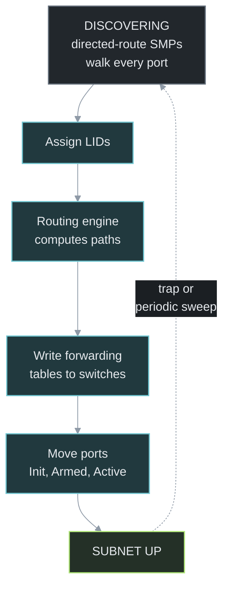
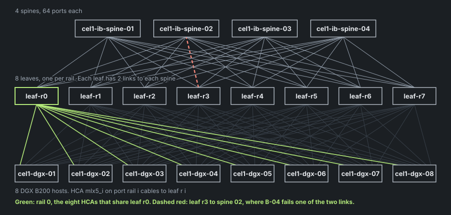

import Excerpt from '../../../components/Excerpt.astro';
import RepoFile from '../../../components/RepoFile.astro';

An Ethernet switch learns where hosts are by watching traffic. An InfiniBand switch learns nothing on its own. A program called the subnet manager (SM) discovers every node and link, gives every port an address, and writes each switch's forwarding table. Until it has done that, no data moves. Track B watches OpenSM, the open-source SM, do this work against a simulated fabric.

## GUIDs and LIDs

Every node and port has a 64-bit GUID that the vendor assigns and that never changes. A node GUID names the device, and a port GUID names one of its ports. GUIDs identify things. They do not route.

Routing inside one subnet uses 16-bit local identifiers (LIDs). The SM hands them out. With an LID mask control (LMC) of 0, each port gets exactly one LID, and every Track B scenario runs with LMC 0. A switch forwards a packet by looking up its destination LID in its linear forwarding table, which maps each LID to an output port. Two checks of every Track B scenario follow from this. `lids-unique` requires a non-zero LID on every linked HCA port and no LID shared by two ports. `routes-shortest` requires every switch to forward every endpoint LID out of a port one hop closer to it.

## SMPs and MADs

Management traffic travels as management datagrams (MADs) of 256 bytes. Each MAD belongs to a management class. Subnet management packets (SMPs) carry the SM's own work and go to queue pair 0 of each port. Other classes, such as subnet administration, which answers path queries, go to queue pair 1.

An SMP can be routed in two ways. A LID-routed SMP uses the forwarding tables, so it works only after the SM has written them. A directed-route SMP carries the list of output ports to take, hop by hop. That is how the SM reaches a switch it has not configured yet. This OpenSM log from B-01 shows the classes it binds: `0x81` is directed-route subnet management and `0x03` is subnet administration.

<Excerpt id="b01-opensm" />

## The sweep

The SM becomes MASTER, walks the fabric with directed-route SMPs, assigns LIDs, runs its routing engine, programs the switches and brings the ports to Active. Its log then says `SUBNET UP`. When a link changes state, the SM learns it from a trap or from its periodic sweep, and sweeps again. [B-03](/labs/track-b/b-03/) times that resweep after a link goes down and after it comes back.

## Port states

A port has a physical state, such as Polling or LinkUp, and a logical state that the SM drives. `iblinkinfo` prints them as a pair, logical first.

| Logical state | Meaning |
|---|---|
| Down | No logical link. With nothing cabled, `iblinkinfo` shows `Down/Polling` |
| Init | The link trained, but the SM has not configured the port yet |
| Armed | Configured, waiting for the SM's final step |
| Active | Configured and carrying traffic. `iblinkinfo` shows `Active/LinkUp` |

`port-states` requires every linked port to be `Active/LinkUp` facing its peer, and every unlinked switch port `Down/Polling`. This is the fabric of B-03 after the link of `hca3` went down. Every remaining link is Active, and the ports without a peer poll.

<Excerpt id="b03-fault-iblinkinfo" />

## Routing engines

The SM's routing engine decides which output port each switch uses for each LID. OpenSM 3.3.23 routes with minhop by default and also supports updn, dnup, file, ftree, lash, dor, torus-2QoS, nue, dfsssp and sssp (`.lab/evidence/m4/probe/09-opensm-options.txt`). [ADR 0005](/docs/adr/0005-track-b-fabric-simulation/) says which engine each scenario uses and why.

**minhop** chooses, for each switch and destination, an output port on a shortest path, and spreads destinations over equal ports. It does not guard against credit loops.

**updn** first ranks the switches by their distance from root switches. A legal path goes up toward the roots, then down, and never turns from down to up. That rule removes every cycle of buffer dependencies, so it cannot deadlock the lossless, credit-based links of InfiniBand. updn needs roots. On a single-tier fabric it finds none and falls back to minhop.

<Excerpt id="b02-updn-fallback" />

That is why B-01 to B-03 keep minhop and B-04, on the two-tier cel1 fabric, uses updn. In a two-tier fabric where every leaf reaches every spine, up/down paths are also shortest, and `routes-shortest` confirmed it for all 768 routes of B-04.

## Rail-optimized fabrics

A GPU server in a training cluster has one HCA per GPU. In a rail-optimized fabric, HCA *i* of every server cables to the leaf switch of rail *i*. Traffic between GPUs of the same rank on different servers then crosses one leaf and no spine. Spines join the rails for everything else.

cel1's compute fabric follows this pattern: 8 DGX B200 hosts with 8 rail ports each, 8 leaves and 4 spines, 64 host links and 64 leaf-to-spine links. `make track-b-render` writes it into an ibsim net file from `sites/cel1.yaml`, and `make track-b-render-check` fails when the two differ. [B-04](/labs/track-b/b-04/) fails one leaf-to-spine link and checks that every route moves around it.

## ibsim and libumad2sim

ibsim simulates a fabric from a net file. It answers MADs as the switches and HCAs of that file would. `libumad2sim.so`, set with `LD_PRELOAD` on OpenSM and each tool, replaces the user-space MAD library's calls with messages to the simulator over a Unix socket. No kernel HCA exists, and no packet crosses a wire. This is the hand-written fabric of B-01.

<RepoFile path="tracks/b-ibsim/topologies/b-01.net" />

And this is what `ibnetdiscover` found in it. The SM gave `hca1` LID 1, `sw1` LID 2 and `hca2` LID 3. ibsim reports every link as 4X SDR.

<Excerpt id="b01-ibnetdiscover" />

> [!WARNING]
> ibsim simulates the management plane only. It shows what OpenSM and the diagnostic tools do. It does not show link speed, width negotiation, physical errors, firmware, IPoIB or any RDMA data path, and its convergence times are those of one simulator process in one guest.

## Primary sources

- InfiniBand Trade Association, [InfiniBand Architecture Specification](https://www.infinibandta.org/ibta-specification/). Volume 1 defines the subnet manager, LIDs, GUIDs, MADs and port states.
- [OpenSM](https://github.com/linux-rdma/opensm), its [`opensm(8)`](https://github.com/linux-rdma/opensm/blob/master/man/opensm.8.in) manual and its description of the [routing engines](https://github.com/linux-rdma/opensm/blob/master/doc/current-routing.txt), minhop and updn among them.
- [ibsim README](https://github.com/linux-rdma/ibsim/blob/master/README), for the simulator, `libumad2sim` and the net file format.
- [infiniband-diags](https://github.com/linux-rdma/rdma-core/tree/master/infiniband-diags) in rdma-core, the source of `ibnetdiscover`, `iblinkinfo`, `ibroute`, `smpquery` and `sminfo`.
- "Rail-only: A Low-Cost High-Performance Network for Training LLMs with Trillion Parameters", [arXiv 2307.12169](https://arxiv.org/abs/2307.12169), which describes rail-optimized fabrics and their traffic.
