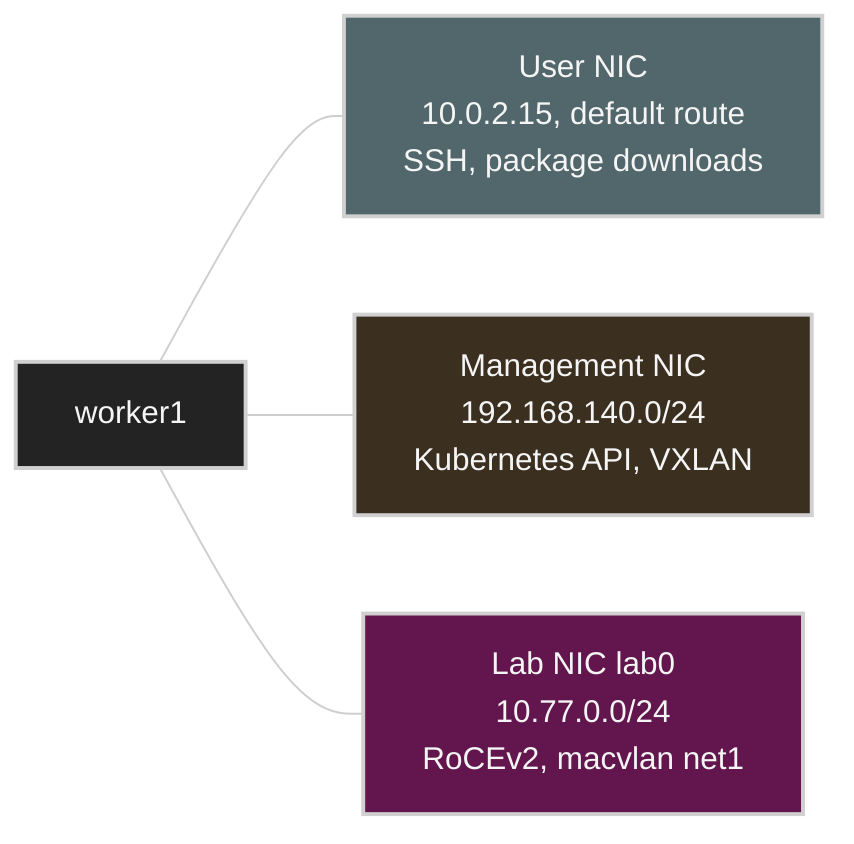
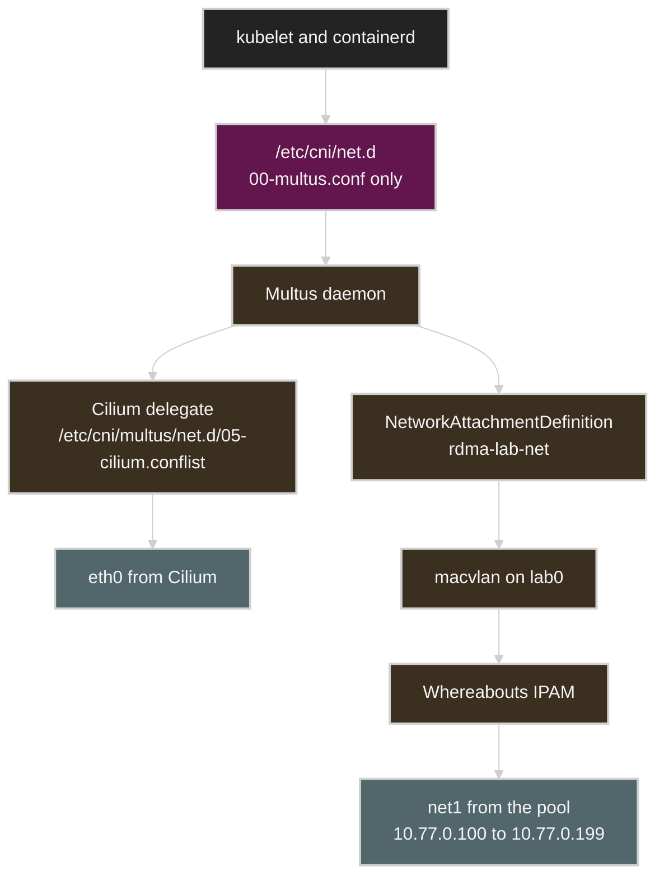

import Excerpt from '../../../components/Excerpt.astro';

Kubernetes gives every pod an IP address and leaves the wiring to plugins. The labs use that freedom in three ways. Cilium gives each pod its primary interface `eth0`. Multus adds a second interface `net1` on the lab network. A hostNetwork pod skips both and shares the node's own network namespace, which is how a container reaches the node's RDMA device.

## Three networks per worker

Each Track A worker has three NICs, and each carries different traffic. The path checks of the labs depend on keeping them apart.

kubelet registers the management address as the node IP, and Cilium's VXLAN tunnel rides on it. The lab network has no default route, so RDMA and `net1` traffic stays on it. The [QEMU harness](/repository/qemu-harness/) page shows how each network is built.

## CNI

The Container Network Interface is a contract between the container runtime and a plugin binary. When a pod starts, containerd reads the first configuration file by name in `/etc/cni/net.d` and runs the plugin it names with the command `ADD`. The plugin creates the interface in the pod's network namespace and asks an IPAM plugin for an address. `DEL` undoes it when the pod stops. Plugins can delegate to other plugins, which is how Multus works.

The order of files in that directory decides which plugin runs. Two of the lab's real failures came from it. A copy of Cilium's file that sorted first made pods start with `eth0` only, and a stray file at boot became Multus's delegate ([troubleshooting](/docs/troubleshooting/) section 12, [ADR 0004](/docs/adr/0004-track-a-pods-and-net1/) section 2.4).

## Cilium

Cilium is the primary CNI. It runs an agent on every node that attaches eBPF programs to the pod interfaces. The lab installs it by Helm with a pinned chart and these choices in `helm/cilium/values-lab.yaml`.

| Setting | Lab value | What it means |
|---|---|---|
| `routingMode` | `tunnel` | Pod traffic between nodes is encapsulated |
| `tunnelProtocol` | `vxlan` | VXLAN over UDP. The chart default port is 8472 |
| `ipam.mode` | `kubernetes` | Each node's pod range comes from the PodCIDR kubeadm assigns |
| `kubeProxyReplacement` | `false` | kube-proxy keeps implementing Services with iptables |
| `cni.exclusive` | `false` | Cilium does not rename other CNI files, so Multus can coexist |
| `cni.confPath` | `/etc/cni/multus/net.d` | Cilium writes its file where only Multus reads it |

**Tunnel mode.** A pod packet to another node is wrapped in a VXLAN header, a UDP datagram and the node's management IP header. [k8s-baseline](/labs/track-a/k8s-baseline/) proves this path from captures. The management NIC must carry VXLAN frames with pod flows in both directions, and the lab NIC must carry none.

**kube-proxy replacement.** cel1 runs without kube-proxy. Cilium then implements ClusterIP Services itself in eBPF, and native routing sends pod traffic unencapsulated over the management network. The [cel1 simulation](/labs/cel1/cel1-sim-baseline/) checks that no node holds a `KUBE` iptables chain and that neither node of the pod traffic test has a VXLAN or Geneve link.

**Reaching the API.** The agent talks to the Kubernetes API. In the first Kubernetes acceptance run a restarted agent could not reach it through the ClusterIP `10.96.0.1`, because the harness default route sits on another NIC than the node IP and a Cilium mark skipped kube-proxy's masquerade. The fix makes Cilium dial the API address directly. The lab reads it from a ConfigMap the kubeadm role writes, and cel1 sets it to its VIP ([ADR 0001](/docs/adr/0001-kubernetes-stack/) section 9).

## kube-vip

A cluster with three control planes needs one address for the API that survives the loss of any one of them. kube-vip runs as a static pod on every control plane. In ARP mode the pods compete for the lease `plndr-cp-lock`, and the holder adds the virtual IP to its interface and announces it with ARP. When the holder dies, its lease expires after 5 seconds, another control plane takes it and announces the address from its own MAC.

[k8s-ha-vip](/labs/track-a/k8s-ha-vip/) cuts the power of the holder and measures how long the API stays silent. The records measured 6.031, 7.538, 9.04 and 9.045 seconds on the ha profile, from the power cut to the first good probe at 0.5-second intervals.

## Multus and the secondary network

Multus is a meta-plugin. In the thick-plugin form the lab uses, `/etc/cni/net.d/00-multus.conf` names a shim, and a daemon on every node does the work. For each pod it first calls its default delegate, Cilium, for `eth0`. Then it reads the pod's annotation and calls the plugin of each named NetworkAttachmentDefinition for `net1`, `net2` and so on.

The lab keeps `00-multus.conf` as the only CNI file in `/etc/cni/net.d`. This is the listing [k8s-multus-net1](/labs/track-a/k8s-multus-net1/) recorded on worker1, and the file it found there.

<Excerpt id="a-multus-cni-ls" />

<Excerpt id="a-multus-conf" lang="json" />

The layout matters after a reboot. The Multus daemon deletes its file when it stops, and before the change Cilium's file stayed in `/etc/cni/net.d`, so containerd ran Cilium alone until Multus wrote its file again. With Cilium's file in its own directory, the node has no network in that window and the kubelet holds new pods until Multus is back.

## Whereabouts and macvlan

**macvlan** creates a child interface on a master NIC, with its own MAC address. In bridge mode, children on the same master reach each other directly. The lab's master is the lab NIC `lab0`, so `net1` packets leave on the same wire as RoCEv2. A macvlan child needs the virtual NIC and switch to pass its extra MAC. The extra-MAC probe showed the frames crossing with the children's own source MACs while `lab0` stayed at promiscuity 0 (`.lab/evidence/m3/probe-macvlan.log`, [ADR 0004](/docs/adr/0004-track-a-pods-and-net1/) section 2.3). ipvlan, which shares the master's MAC, was the fallback and was not needed.

**Whereabouts** is an IPAM plugin that allocates addresses across the whole cluster from a pool stored in Kubernetes objects. Node-local IPAM would hand the same address to pods on two nodes. The lab pool is `10.77.0.100` to `10.77.0.199`, inside the lab network and outside every node address. The runner renders the attachment from the inventory alone.

<Excerpt id="a-multus-route" />

That routing table of a `net1` pod shows the rule [k8s-multus-net1](/labs/track-a/k8s-multus-net1/) checks. The default route stays on `eth0`, and `net1` carries only its own subnet.

## hostNetwork pods with RDMA devices

A pod with `hostNetwork: true` shares the node's network namespace. It sees the node's NICs, addresses and RDMA devices, and it can bind the lab NIC address. The RDMA host namespace mode is `shared`, so every such pod sees the whole device. This is the simplest way to run RDMA in a container, and the most exposed.

To open the device, the container needs the character files under `/dev/infiniband`, permission from the device cgroup, and enough locked memory for its registrations. The lab tried the profiles from narrowest to broadest.

| Profile | Result |
|---|---|
| PodSecurity `restricted` or `baseline` namespace | Refused at admission. `hostNetwork` needs the `privileged` level |
| `privileged` level, all capabilities dropped, no device | No `/dev/infiniband`. `ibv_devinfo` exits 255 with `No IB devices found` |
| The same with `/dev/infiniband` as a hostPath | The files appear, but the device cgroup refuses `uverbs0` and `rdma_cm` with `Operation not permitted` |
| `privileged: true`, uid 65534, no capability, no host PID, IPC or volume | `rxe0` is `PORT_ACTIVE` and the RDMA tests pass |

Kubernetes has no field that admits one character device to a container without a device plugin, and capabilities do not change the device cgroup. So the lab RDMA pods run `privileged` ([ADR 0004](/docs/adr/0004-track-a-pods-and-net1/) section 2.1). A device plugin that would remove it is an open experiment.

> [!NOTE]
> `net1` is an IP network only. RXE lists the `net1` addresses as GIDs, but no pod got an RDMA device on `net1`. A hostNetwork pod proves that a container can use the node's device, not that a pod has its own RDMA interface.

## Primary sources

- Kubernetes, [Cluster networking](https://kubernetes.io/docs/concepts/cluster-administration/networking/), [Network plugins](https://kubernetes.io/docs/concepts/extend-kubernetes/compute-storage-net/network-plugins/), [Pod Security Standards](https://kubernetes.io/docs/concepts/security/pod-security-standards/) and [Creating highly available clusters with kubeadm](https://kubernetes.io/docs/setup/production-environment/tools/kubeadm/high-availability/).
- CNI, [the specification](https://www.cni.dev/docs/spec/), the [macvlan plugin](https://www.cni.dev/plugins/current/main/macvlan/) and the [ipvlan plugin](https://www.cni.dev/plugins/current/main/ipvlan/).
- Cilium, [Routing](https://docs.cilium.io/en/stable/network/concepts/routing/), [Kubernetes without kube-proxy](https://docs.cilium.io/en/stable/network/kubernetes/kubeproxy-free/) and the [Helm reference](https://docs.cilium.io/en/stable/helm-reference/).
- [RFC 7348](https://www.rfc-editor.org/rfc/rfc7348), VXLAN.
- [kube-vip documentation](https://kube-vip.io/docs/), and [RFC 5227](https://www.rfc-editor.org/rfc/rfc5227) for the ARP announcements it relies on.
- Multus, [quickstart](https://github.com/k8snetworkplumbingwg/multus-cni/blob/master/docs/quickstart.md) and [thick plugin](https://github.com/k8snetworkplumbingwg/multus-cni/blob/master/docs/thick-plugin.md).
- [Whereabouts](https://github.com/k8snetworkplumbingwg/whereabouts).
