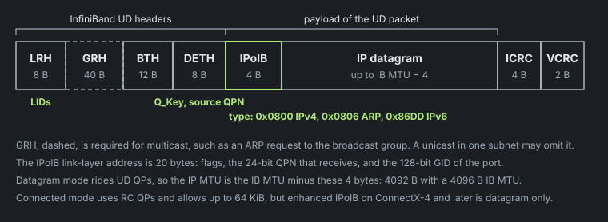

import Excerpt from '../../../components/Excerpt.astro';

A DGX node has eight GPUs and eight InfiniBand ports, one HCA per GPU, and each port goes to its own rail of a [rail-optimized fabric](/concepts/infiniband-management/#rail-optimized-fabrics). A training job in a Kubernetes pod needs those rails. The pod network that [Cilium](/concepts/kubernetes-networking/#cilium) gives it runs over the management port and cannot carry that traffic. This page explains how a pod reaches the rails, using the pieces [ADR 0007](/docs/adr/0007-cel1-ipoib-pod-networks/) chose for cel1. It builds on [RDMA](/concepts/rdma/), [Kubernetes networking](/concepts/kubernetes-networking/) and [InfiniBand management](/concepts/infiniband-management/).

## Two paths on one rail

A rail carries two kinds of traffic, and they need different things inside the pod.

| Traffic | How it uses the rail | What the pod needs |
|---|---|---|
| NCCL collectives, the bulk of the bytes | Verbs. NCCL opens queue pairs on the HCA and moves data without the kernel's IP stack. `NCCL_IB_HCA` names the HCAs | The HCA's character devices under `/dev/infiniband`, and room to lock memory |
| RDMA CM, MPI and UCX that resolve a peer by address, IP tools on the fabric | IP over the rail. RDMA CM turns a peer's IP address into its InfiniBand address before it opens a queue pair | An IP interface on the rail: IPoIB |
| NCCL's bootstrap, Services, DNS | TCP on the pod network | `eth0` from Cilium. `NCCL_SOCKET_IFNAME=eth0` keeps the bootstrap there |

So a pod on the rails gets two things per rail: RDMA devices for verbs and an IPoIB interface for IP. The two are independent. NCCL runs without IPoIB, and IPoIB runs without any RDMA device in the pod.

## IPoIB

IP over InfiniBand (IPoIB) carries IP and ARP datagrams as the payload of InfiniBand packets. In datagram mode it sends them on unreliable datagram (UD) queue pairs. Each datagram gets a 4-byte header that names the protocol inside.

Compare it with the [RoCEv2 frame](/concepts/rdma/#the-rocev2-frame). RoCEv2 wraps the InfiniBand transport in Ethernet, IP and UDP. IPoIB does the reverse and wraps IP in the InfiniBand transport, so it needs a port whose link layer is InfiniBand.

- **Addresses.** An IPoIB interface has a 20-byte hardware address: flags, the 24-bit number of the QP that receives, and the 128-bit GID of the port. The kernel registers it as `ARPHRD_INFINIBAND` with a hardware address length of 20. ARP maps an IP address to this, and a request goes to the partition's broadcast group, an InfiniBand multicast group.
- **MTU.** In datagram mode the IP MTU is the InfiniBand MTU minus the 4-byte header. A fabric with a 4096-byte IB MTU gives 4092. Connected mode sends on reliable connected QPs and allows up to 64 KiB. ConnectX-4 and later run enhanced IPoIB, which offloads datagram mode and does not support connected mode.
- **Interfaces.** The kernel module `ib_ipoib` creates one interface per InfiniBand port, named `ib0`, `ib1` and so on. cel1 renames them to `rail0` to `rail7` with systemd `.link` files ([site model](/repository/cel1-site-model/)). `/sys/class/net/<name>/mode` reads and sets datagram or connected.

> [!NOTE]
> The kernel adds IPoIB only to ports whose protocol is InfiniBand. `ipoib_add_one` skips every other port, so a Soft-RoCE port, which is Ethernet underneath, never gets an IPoIB interface. That is why no part of this lab can run the IPoIB data path.

## Partitions and child interfaces

An InfiniBand partition plays the role of a VLAN. The subnet manager assigns each port the partition keys (P_Keys) it may use, and a packet with a key the receiving port lacks is dropped at the port. The default partition has the key `0x7fff`, and a port that is a full member of it carries `0xffff`, the key with its high bit set.

An IPoIB interface lives in one partition. Writing a P_Key to the parent's `create_child` makes a child interface in that partition: `echo 0x8001 > /sys/class/net/ib0/create_child` creates `ib0.8001`. ipoib-cni uses the same kernel mechanism. It makes a child of the rail it is given and moves it into the pod, and the child joins the partition of its parent.

This is the isolation that matters on the rails. A Cilium NetworkPolicy filters `eth0` only. Two pods on the same partition of a rail can reach each other whatever the policy says. Two tenants are kept apart by partitions, which the subnet manager enforces in the fabric, and by a P_Key child as the parent of each tenant's network.

## Three ways to put a rail into a pod

| Way | What the pod sees | Isolation | Needs |
|---|---|---|---|
| `hostNetwork: true` | The node's own rail interfaces, addresses and RDMA devices | None. The pod shares the node's network namespace and ports | Nothing extra. Track A runs its RDMA pods this way on RXE |
| An IPoIB child per rail through Multus and ipoib-cni, with a shared RDMA device plugin | Its own `rail0` to `rail7` with pool addresses, and the HCAs' devices | Partition of the parent. Pods on one node share the HCAs | Multus, ipoib-cni, an IPAM plugin, a device plugin |
| An SR-IOV virtual function per pod, with `ib-kubernetes` | Its own VF with its own GUID and P_Key | Per pod, set in the fabric | SR-IOV in the HCA firmware, the SR-IOV Network Operator, and UFM, which `ib-kubernetes` drives |

cel1 takes the second way. One training job per DGX node is the common case, so sharing the eight HCAs costs little, and it needs neither firmware changes nor a fabric manager ([ADR 0007](/docs/adr/0007-cel1-ipoib-pod-networks/) section 2.4).

## RDMA devices in a pod

A container opens an RDMA device through files such as `/dev/infiniband/uverbs0` and `/dev/infiniband/rdma_cm`. Two gates stand in the way: the file must exist inside the container, and the container's device cgroup must allow it. Track A found that a hostPath of `/dev/infiniband` passes the first gate and fails the second with `Operation not permitted`, and that no capability changes the device cgroup. Its RDMA pods therefore run `privileged` ([Kubernetes networking](/concepts/kubernetes-networking/#hostnetwork-pods-with-rdma-devices)).

A device plugin removes that need. It registers a resource with the kubelet, such as `rdma/cel1_rails`. When a pod asks for a unit, the kubelet adds the plugin's device files to the container, device cgroup included. The pod then needs only `IPC_LOCK`, so that verbs can pin the memory they register. `IPC_LOCK` is not among the capabilities PodSecurity `baseline` allows, so the namespace still runs at the `privileged` level while the container is not privileged.

The RDMA shared device plugin selects HCAs and exposes them as one resource that many pods share. cel1's resource selects the HCAs of `rail0` to `rail7` by netdev name and lets 16 pods per node hold it (`rdmaHcaMax`). One unit gives a pod all eight HCAs. The SR-IOV device plugin instead hands each pod a VF of its own.

The plugin finds an HCA by walking the PCI network functions of the node and reading each one's RDMA devices from `/sys/bus/pci/devices/<address>/infiniband`. A ConnectX port has its device there. A Soft-RoCE device has none:

<Excerpt id="cel1-rails-rxe-sysfs" />

<Excerpt id="cel1-rails-rxe-no-pci" />

So no software RDMA device can stand in for an HCA in front of this plugin. On the cel1 simulation the plugin loads its configuration, rejects every NIC and registers the resource with no device:

<Excerpt id="cel1-rails-plugin" />

The message names `rdma_cm` only because it is the first device the plugin requires and finds nothing under the PCI function.

## Addresses on the rails

Each IPoIB child needs an address on its rail, and an IPAM plugin hands it out. The lab's `net1` uses Whereabouts, which records every allocation in a cluster-wide object. cel1 uses nv-ipam, which the operator manages. Its controller gives each node a block of the pool, and the node agent allocates from that block alone, so an allocation needs no cluster-wide write.

nv-ipam hands out blocks in node order from the first address of the subnet. On cel1 each rail's pool, `10.143.<r>.0/24`, gave the eight DGX nodes the blocks .1 to .16 up to .113 to .128. A pool inside the hosts' rail subnet, `10.142.<r>.0/24`, would have put the second node's block, .17 to .32, over the host addresses .21 to .28, so the pods got a range of their own ([ADR 0007](/docs/adr/0007-cel1-ipoib-pod-networks/) section 2.5). Pods and hosts still share the rail's partition.

## The NVIDIA Network Operator

The operator installs the networking stack of a node as DaemonSets. One custom resource, the `NicClusterPolicy`, lists the components it runs. Each IPoIBNetwork it receives becomes a NetworkAttachmentDefinition that Multus reads, and nv-ipam reads its pools from the operator's namespace.

| Component | What it does | cel1 |
|---|---|---|
| `ofedDriver` | Builds and loads the DOCA driver in a container | Left out. DGX OS ships the driver |
| `rdmaSharedDevicePlugin` | The RDMA shared device plugin | On, `rdma/cel1_rails` |
| `nvIpam` | The nv-ipam controller and node agent | On |
| `secondaryNetwork.ipoib` | Copies the ipoib-cni binary to each node | On |
| `secondaryNetwork.multus` | Its own Multus | Left out. The repository's Multus chart is the only one |
| `secondaryNetwork.cniPlugins` | The standard CNI plugins | Left out. The `containerd` role installs the locked ones |

The operator decides where the device plugin runs by labels as well. It adds the node selector `feature.node.kubernetes.io/pci-15b3.present=true`, a label that Node Feature Discovery gives a node with a Mellanox PCI device, and it marks such nodes `network.nvidia.com/operator.mofed.wait=false` when it manages no driver. On a DGX node the GPU Operator's NFD sets the PCI label for the ConnectX ports. On the simulation guests, which have no such device, the plugin's DaemonSet scheduled no pod until a stand-in set the label.

## How cel1 puts it together

The pod names its networks in the annotation `k8s.v1.cni.cncf.io/networks`. Multus gives it `eth0` through Cilium first, then calls ipoib-cni once per named network. ipoib-cni makes the IPoIB child of the rail and nv-ipam gives it an address. The device plugin adds the HCAs' devices because the pod asks for `rdma/cel1_rails`. The lab [cel1-rail-networks](/labs/cel1/cel1-rail-networks/) checks every step the simulation can hold, and shows where an Ethernet rail must stop: the device plugin finds no RDMA device, and ipoib-cni refuses each rail with `master device is (device) not of type ipoib`.

## Primary sources

- [RFC 4391](https://www.rfc-editor.org/rfc/rfc4391), IP over InfiniBand datagram mode: the encapsulation header, the link-layer address, the broadcast group and the GRH. [RFC 4392](https://www.rfc-editor.org/rfc/rfc4392), the IPoIB architecture. [RFC 4755](https://www.rfc-editor.org/rfc/rfc4755), connected mode.
- The Linux kernel, [IP over InfiniBand](https://docs.kernel.org/infiniband/ipoib.html): child interfaces, datagram and connected mode, the MTU. `drivers/infiniband/ulp/ipoib/ipoib_main.c` for the ports it skips.
- NVIDIA, [MLNX_OFED, IP over InfiniBand](https://docs.nvidia.com/networking/display/mlnxofedv586042lts/ip+over+infiniband+(ipoib)) on enhanced IPoIB and connected mode, and the [Network Operator deployment guide](https://docs.nvidia.com/networking/display/kubernetes2670/deployment-guide-kubernetes.html) with its IPoIB network.
- [ipoib-cni](https://github.com/Mellanox/ipoib-cni), [nvidia-k8s-ipam](https://github.com/Mellanox/nvidia-k8s-ipam), the [RDMA shared device plugin](https://github.com/Mellanox/k8s-rdma-shared-dev-plugin) and [rdmamap](https://github.com/Mellanox/rdmamap).
- Kubernetes, [Device plugins](https://kubernetes.io/docs/concepts/extend-kubernetes/compute-storage-net/device-plugins/). Multus, [the thick plugin](https://github.com/k8snetworkplumbingwg/multus-cni/blob/master/docs/thick-plugin.md).
- NCCL, [environment variables](https://docs.nvidia.com/deeplearning/nccl/user-guide/docs/env.html), `NCCL_IB_HCA` and `NCCL_SOCKET_IFNAME`.
