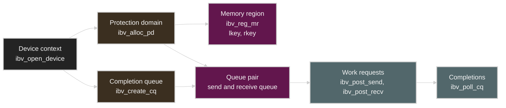
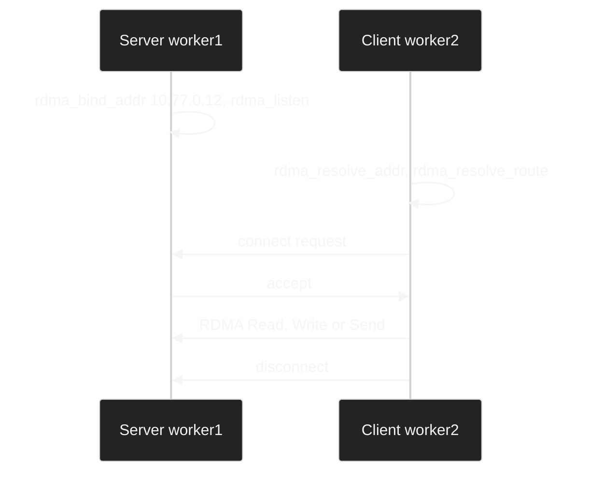
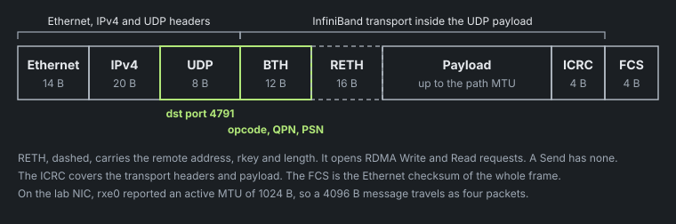

import Excerpt from '../../../components/Excerpt.astro';

Remote Direct Memory Access lets one host read or write the memory of another without the remote CPU copying the data. An application posts work to a queue that the RDMA device reads directly, and the device moves the bytes between registered buffers. The kernel sets the objects up, then steps out of the data path. Track A uses this model with a software device, so the same programs run without an HCA.

## Verbs and the objects they create

The verbs API, `libibverbs` in rdma-core, is the user-space interface to an RDMA device. A program builds a small set of objects, each owned by the one before it.



- **Memory region (MR).** `ibv_reg_mr` pins a buffer and gives it two keys. The local key lets this host's work requests use the buffer. The remote key, `rkey`, lets a peer name the buffer in one-sided operations. Pinning counts against the `RLIMIT_MEMLOCK` of the process, which is why [k8s-hostnet-rdma](/labs/track-a/k8s-hostnet-rdma/) records the memlock limits inside its pods.
- **Queue pair (QP).** A send queue and a receive queue that belong together. A reliable connected QP talks to exactly one remote QP. It moves through the states RESET, INIT, RTR (ready to receive) and RTS (ready to send) before it carries traffic.
- **Completion queue (CQ).** The device writes one completion per finished work request. perftest polls it in a busy loop, which showed as vCPU threads near 90% during the bandwidth tests (`.lab/limiter/20261115T023119Z/`).

## Send, RDMA Write and RDMA Read

| Operation | Sides involved | What the peer must do |
|---|---|---|
| Send | Two-sided | Post a receive buffer first. The data lands in the next posted receive, and both sides get a completion |
| RDMA Write | One-sided | Nothing during the transfer. The writer names the remote address and `rkey`. The target CPU sees no completion |
| RDMA Read | One-sided | Nothing during the transfer. The reader names the remote address and `rkey`, and the target device answers from its memory |

perftest has one tool per operation: `ib_send_bw`, `ib_write_bw` and `ib_read_bw`. [vm-rxe-baseline](/labs/track-a/vm-rxe-baseline/) runs all three, because each takes a different path through the device and a fault can break one and not the others.

## RDMA CM, the connection manager

A reliable QP needs the peer's QP number, its starting packet sequence number and an address to reach it. RDMA CM, `librdmacm`, exchanges these for the application in a way that looks like sockets. The server binds an address and listens. The client resolves the address to a device and port, resolves a route, and connects. RDMA CM moves both QPs through their states.



The lab runners use RDMA CM on both tools, `rping` and perftest with `-R`, and set no GID index by hand. A server counts as ready when `rdma resource show cm_id` lists its LISTEN entry. This line from the RXE prerequisite probe shows one.

<Excerpt id="a-probe-rping" />

rping with `-V` checks the bytes of every ping on arrival, so a passing run proves the data, not only the connection.

## The RoCEv2 frame

RoCE carries the InfiniBand transport over Ethernet. RoCEv2 puts it inside UDP and IP, so a RoCEv2 packet crosses switches and routers like any UDP packet. The receiver recognizes it by the UDP destination port 4791.



The base transport header (BTH) names the opcode, the destination QP number and the packet sequence number. A one-sided request adds the RDMA extended header (RETH) with the remote address, the `rkey` and the length. The lab path check counts exactly these frames. [vm-rxe-baseline](/labs/track-a/vm-rxe-baseline/) requires RoCEv2 frames between the two lab addresses on the lab NIC, and none on the management NIC.

## GIDs and address resolution

On RoCE, a port's global identifiers (GIDs) come from the IP addresses of its network device. An IPv4 address appears as an IPv4-mapped IPv6 GID. RDMA CM picks the GID index that matches the address it resolved. perftest prints the GIDs of both ends.

<Excerpt id="a-write-bw-client" />

`255:255:10:77:00:13` is the IPv4-mapped form of `10.77.0.13`, worker2's lab address, and `GID index : 1` is the index rdma_cm chose. Because the GID table follows addresses, an address change on the netdev changes the table. The extra-MAC probe saw `rxe0` gain two GIDs for each macvlan child on its lab NIC while the child existed, even though the child sat in another network namespace (`.lab/evidence/m3/probe-macvlan.log`).

## Soft-RoCE and RXE

RXE is the kernel module `rdma_rxe`. It implements RoCEv2 in software on top of any Ethernet device, and the rdma-core provider `librxe` gives it the verbs interface. One command attaches it to a NIC.

```bash
rdma link add rxe0 type rxe netdev <lab NIC>
```

This is the first RXE device of the lab, created by hand in the prerequisite probe `20261115T012426Z` before any role existed.

<Excerpt id="a-probe-rxe-link" />

The device reports InfiniBand transport and an Ethernet link layer. Its firmware version and vendor id are placeholders, because no hardware exists. The guest kernel 6.8.0-147-generic of the cloud image had no `rdma_rxe`. `linux-modules-extra` of the same kernel provides it, and the `common` role installs that package only when `modinfo rdma_rxe` fails ([troubleshooting](/docs/troubleshooting/) section 2).

> [!IMPORTANT]
> RXE runs in the CPU of the guest. Its bandwidth is a property of this host, kernel and guest combination, not of any RDMA hardware. Track A records it with no pass threshold.

## Primary sources

- InfiniBand Trade Association, [InfiniBand Architecture Specification](https://www.infinibandta.org/ibta-specification/). Volume 1 defines verbs, queue pairs and the transport headers. Annex A17 defines RoCEv2.
- Linux kernel documentation, [Userspace verbs access](https://docs.kernel.org/infiniband/user_verbs.html) and the [InfiniBand and RDMA index](https://docs.kernel.org/infiniband/index.html).
- rdma-core, [Soft-RoCE (rxe)](https://github.com/linux-rdma/rdma-core/blob/master/Documentation/rxe.md), [libibverbs](https://github.com/linux-rdma/rdma-core/blob/master/Documentation/libibverbs.md), [`ibv_reg_mr(3)`](https://github.com/linux-rdma/rdma-core/blob/master/libibverbs/man/ibv_reg_mr.3), [`ibv_create_qp(3)`](https://github.com/linux-rdma/rdma-core/blob/master/libibverbs/man/ibv_create_qp.3), [`rdma_cm(7)`](https://github.com/linux-rdma/rdma-core/blob/master/librdmacm/man/rdma_cm.7) and [`rping(1)`](https://github.com/linux-rdma/rdma-core/blob/master/librdmacm/man/rping.1).
- iproute2, [`rdma(8)`](https://man7.org/linux/man-pages/man8/rdma.8.html), [`rdma-link(8)`](https://man7.org/linux/man-pages/man8/rdma-link.8.html) and [`rdma-system(8)`](https://manpages.ubuntu.com/manpages/noble/man8/rdma-system.8.html).
- [perftest](https://github.com/linux-rdma/perftest), the source of `ib_read_bw`, `ib_write_bw` and `ib_send_bw`.
- Linux kernel documentation, [IP over InfiniBand](https://docs.kernel.org/infiniband/ipoib.html), and [RFC 4391](https://www.rfc-editor.org/rfc/rfc4391), for the IPoIB data path the lab does not have.
