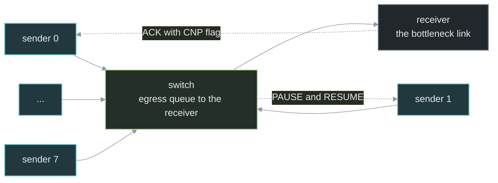
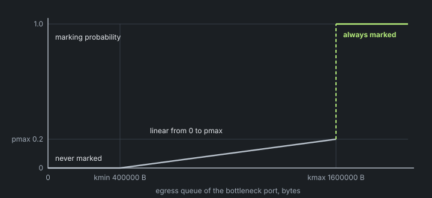

import Excerpt from '../../../components/Excerpt.astro';

RDMA transports were designed for a fabric that does not drop packets. A reliable connected QP recovers a loss with go-back-N, which resends everything after the gap, so even a little loss costs a lot of throughput. RoCE deployments therefore make the RDMA priority lossless with PFC, and keep queues short with ECN and a rate controller, DCQCN. Track C studies these three mechanisms inside a packet model.

## Incast, the case that needs them

Incast means many senders send to one receiver at once. Every sender's link is idle enough, but the switch port toward the receiver must carry the sum. Its egress queue grows until the senders slow down, the switch pauses them, or the buffer overflows.

The Track C incast scenarios put 2, 4 or 8 senders and one receiver on one switch, every link 100 Gbps with 1 us of propagation delay. A fan-in of 8 has nine endpoints. Every flow has priority 3.

## PFC and its headroom

Priority-based Flow Control, IEEE 802.1Qbb, lets a switch pause one traffic priority on a link while the others keep flowing. When an ingress queue of that priority crosses its threshold, the switch sends PAUSE to the upstream port. When the queue drains, it sends RESUME. The upstream sender stops transmitting that priority in between.

A PAUSE takes time to arrive and act. The bytes already on the wire, plus those the sender emits before it stops, still land at the switch. The switch reserves headroom for them per port. The model used here reserves three times the bandwidth-delay product of the port.

$$
\text{headroom} = 3 \times \frac{C \times d}{8} = 3 \times \frac{10^{11}\ \text{bit/s} \times 10^{-6}\ \text{s}}{8} = 37500\ \text{B}
$$

The pause threshold of the model is dynamic. It is the free part of the buffer shifted right by `pfc_alpha_shift`, $(\text{buffer} - \text{headroom} - \text{reserve} - \text{shared}) \gg 3$, so it falls as the shared buffer fills (`switch-mmu.cc:93` at ns-3-alibabacloud `3e0c7c1`).

PFC trades loss for blocking. A paused priority stops every flow on that link, including flows that do not cross the congested port, and pauses can spread upstream hop by hop. The SIGCOMM 2016 paper below describes the deadlocks and storms this caused at scale.

> [!NOTE]
> In the ns-3 model at this commit, the switch sends PAUSE in every profile. "PFC off" means the hosts ignore the PAUSE they receive, not that the switch stops sending it ([ADR 0006](/docs/adr/0006-track-c-packet-model/) section 2).

## ECN marking with kmin, kmax and pmax

Explicit Congestion Notification, RFC 3168, lets a switch mark a packet instead of dropping it. The mark is the CE codepoint in the IP header. The switch marks with a probability that depends on its queue, in the RED style that DCQCN uses.

$$
p(q) =
\begin{cases}
0 & q \le k_{\min} \\
p_{\max} \dfrac{q - k_{\min}}{k_{\max} - k_{\min}} & k_{\min} < q \le k_{\max} \\
1 & q > k_{\max}
\end{cases}
$$

The lab values are SimAI's for 100 Gbps: kmin 400000 B, kmax 1600000 B and pmax 0.2. In the model, q is the egress bytes of the port, and the switch decides at dequeue. `ecn-as-configured` checks the curve from the model's own marks. Across the 200 incast cases of run `20261116T151213Z`, no mark fell at or below kmin, every dequeue above kmax was marked, and between them 2.1% to 12.3% of dequeues were marked, below pmax as the linear curve requires.

## CNPs and DCQCN

The receiver of a CE-marked packet tells the sender with a congestion notification packet (CNP). The sender's rate controller then slows that QP. In this model, for CC mode 1, the CNP is a flag on the ACK of the marked packet, not a separate packet.

DCQCN keeps a congestion estimate $\alpha$ per QP and a current rate $R_C$. The SIGCOMM 2015 paper gives the reaction to a CNP, with gain $g$.

$$
R_T \leftarrow R_C, \qquad R_C \leftarrow R_C \left(1 - \frac{\alpha}{2}\right), \qquad \alpha \leftarrow (1 - g)\,\alpha + g
$$

Without CNPs, $\alpha$ decays and a timer and a byte counter raise the rate again, first halfway back to the target $R_T$ (fast recovery), then by additive steps. The parameters decide how deep a cut goes and how long the recovery waits. Track C sets SimAI's values: rate decrease at most every 4 us, $g = 1/256$, a 900 us recovery timer, one fast recovery step and a 100 Mb/s floor.

This is what those values did to flow 0 at fan-in 8 under ECN with DCQCN. The rate halves every 4 us from 27 us to 63 us and reaches the 100 Mb/s floor. Fast recovery waits for the 900 us timer after the last cut, so the rate stays at the floor until 1051 us and then jumps to 50.05 Gbps, halfway to its target.

<Excerpt id="c03-rates-flow0" />

So in this model, with these values, ECN with DCQCN made large flows several times slower than PFC alone. That is a property of the parameters, which [c-03](/labs/track-c/c-03-incast-simultaneous/) explains in full.

## Flow completion time and its bounds

The flow completion time (FCT) is the simulated time from a flow's start to its completion. A flow alone on a path can never finish faster than its payload takes on the slowest link plus the propagation delay.

$$
\text{FCT} \ge \frac{8 \times \text{payload bytes}}{C_{\text{bottleneck}}} + d_{\text{prop}}
$$

For one flow of 1000000 bytes over two 100 Gbps links of 1 us, the bound is 80000 ns plus 2000 ns, 82000 ns. The model gave 88092 ns, and [c-02](/labs/track-c/c-02-single-flow/) accounts for every one of the 6092 ns above the bound. In incast, every case must also take at least as long as the receiver link needs for all the payload of that case. `fct-bounds` checks both and fails a model that beats physics, as the break `rate-not-applied` showed.

Few flows give few samples. A fan-in of 8 over five seeds gives 40 large flows. The lab reports their minimum, median and maximum and never a tail percentile.

> [!WARNING]
> Track C results are the behavior of the ns-3-alibabacloud model at one pinned commit with one patch, for the parameters given. They are not the behavior of a NIC, a switch ASIC or a production network, and their link rates are not comparable with the RXE bandwidth of Track A.

## Primary sources

- IEEE 802.1, [802.1Qbb Priority-based Flow Control](https://1.ieee802.org/dcb/802-1qbb/).
- [RFC 3168](https://www.rfc-editor.org/rfc/rfc3168), The Addition of Explicit Congestion Notification (ECN) to IP.
- InfiniBand Trade Association, [InfiniBand Architecture Specification](https://www.infinibandta.org/ibta-specification/), whose RoCEv2 annex defines the CNP.
- "Congestion Control for Large-Scale RDMA Deployments", SIGCOMM 2015, the DCQCN paper, [doi:10.1145/2785956.2787484](https://doi.org/10.1145/2785956.2787484), also [as PDF](https://conferences.sigcomm.org/sigcomm/2015/pdf/papers/p523.pdf).
- "RDMA over Commodity Ethernet at Scale", SIGCOMM 2016, on PFC in practice, [doi:10.1145/2934872.2934908](https://doi.org/10.1145/2934872.2934908).
- [ns-3 documentation](https://www.nsnam.org/documentation/), and [ns-3-alibabacloud](https://github.com/aliyun/ns-3-alibabacloud), the model with QBB, PFC, ECN, CNP and DCQCN that Track C runs.
- [SimAI](https://github.com/aliyun/SimAI) and its [installation guide](https://github.com/aliyun/SimAI/blob/master/docs/getting_started/installation.md), the build path and the configuration values Track C uses.
