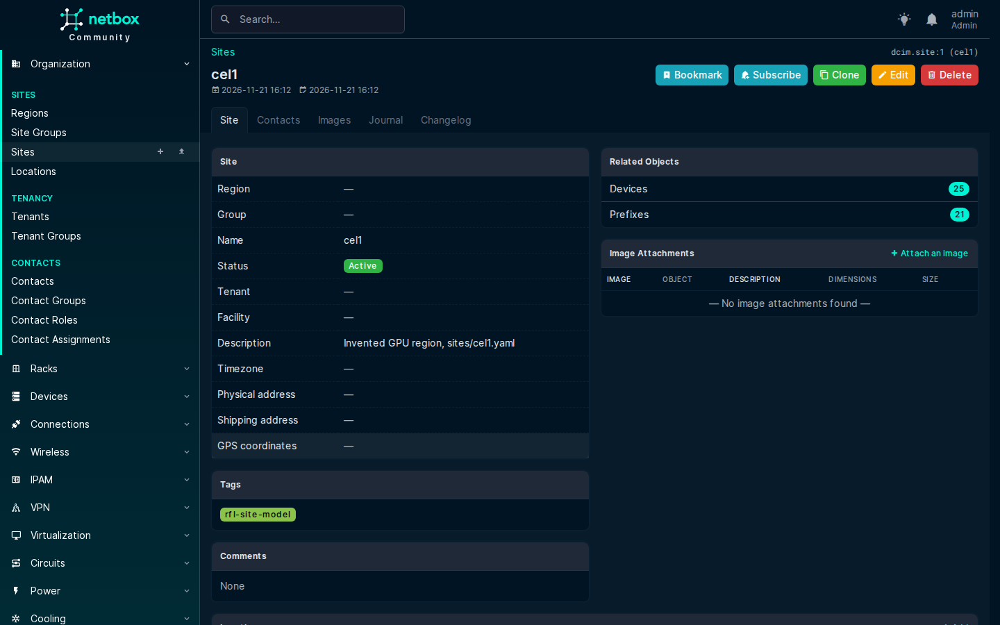
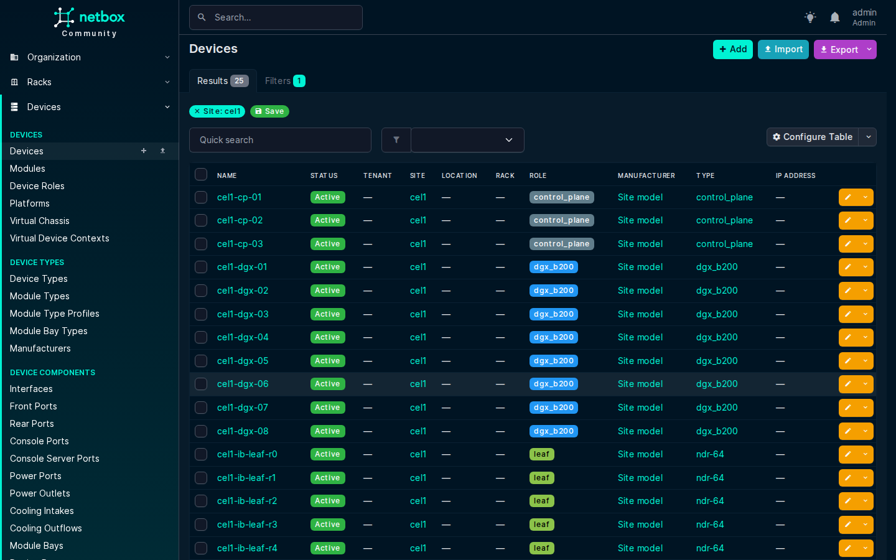
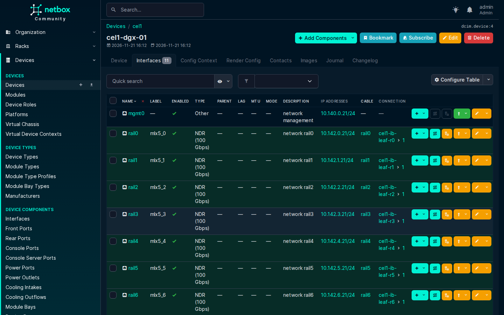
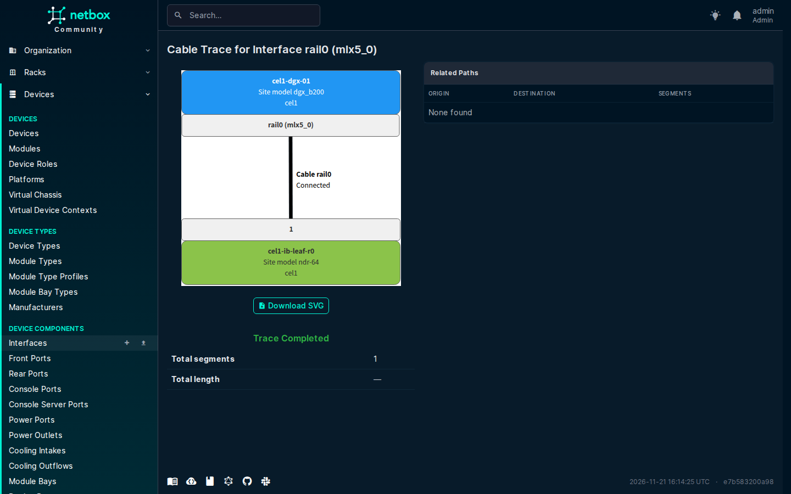
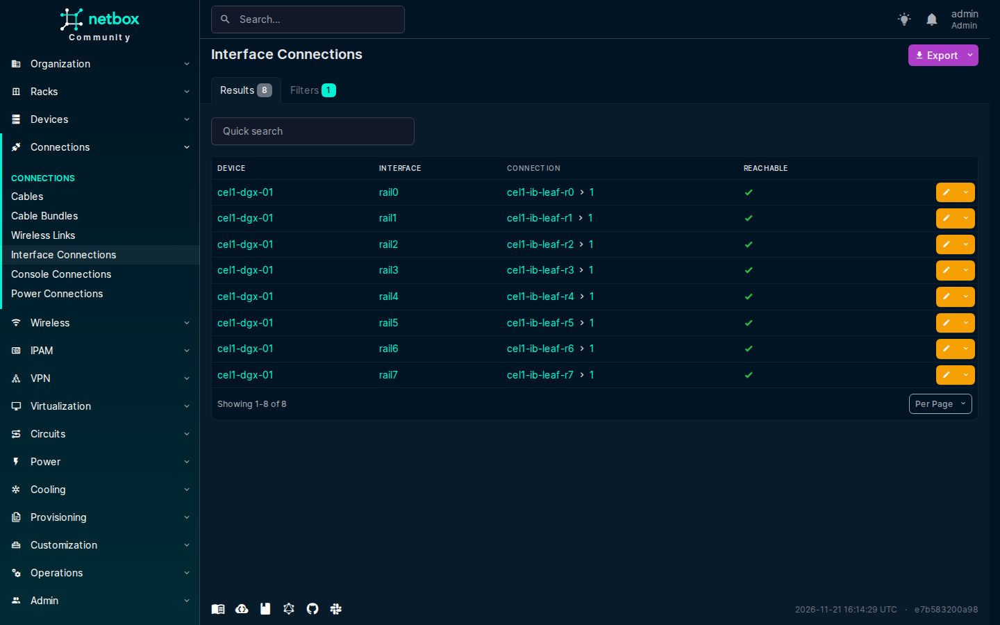
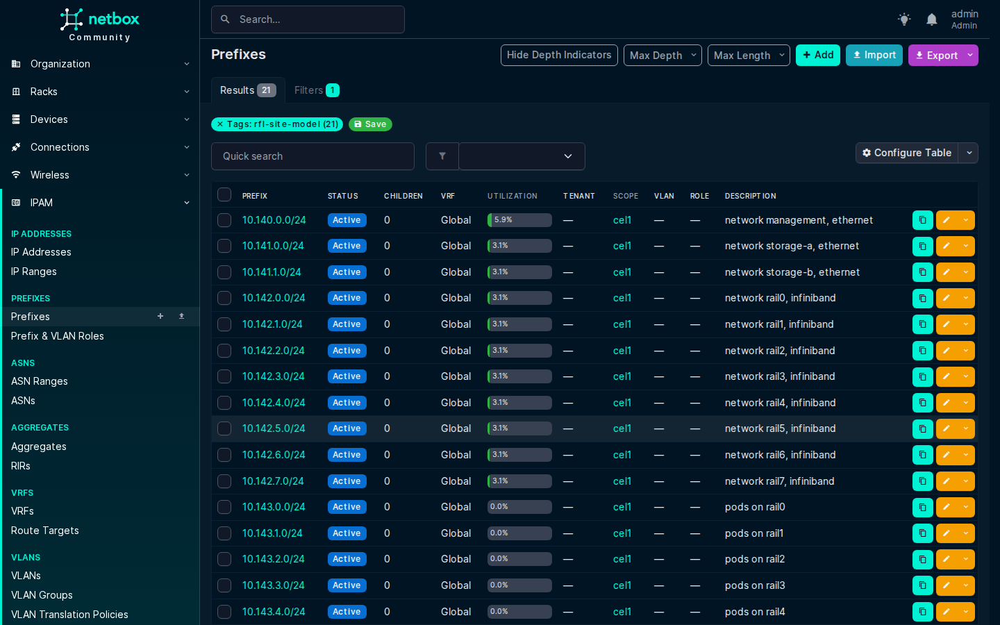
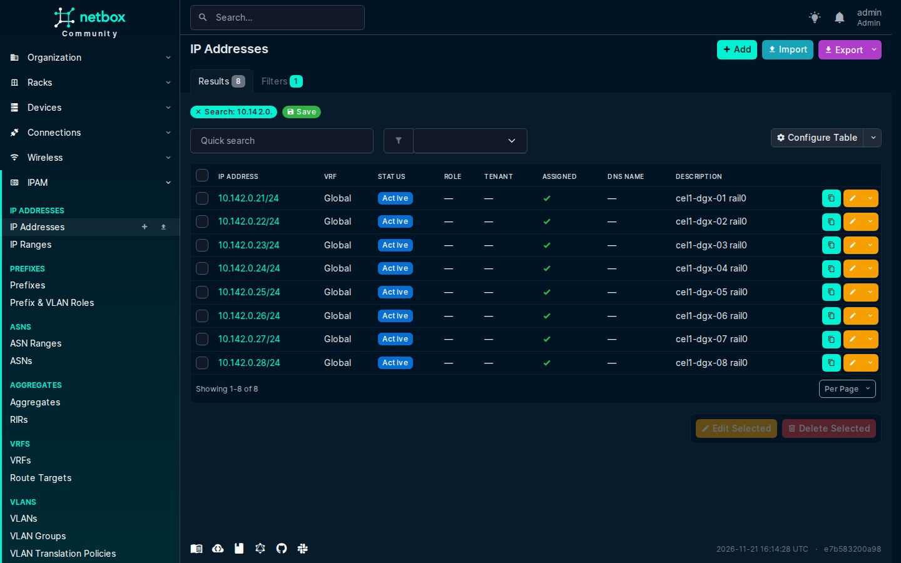

import Excerpt from '../../../../components/Excerpt.astro';
import ScenarioChecks from '../../../../components/ScenarioChecks.astro';

A site that runs [NetBox](https://github.com/netbox-community/netbox) keeps its devices, interfaces, addresses and cables there. cel1 keeps them in `sites/cel1.yaml`, which a validator checks. [ADR 0008](/docs/adr/0008-netbox-from-the-site-model/) exports the model to NetBox and keeps the model as the source. This lab runs that export against a real NetBox in a guest and checks what it promises.

## Goal

Show that `make netbox-sync` makes NetBox hold exactly the 1142 objects the model asks for, that a second sync changes nothing, that drift made by hand in NetBox is named exactly and undone, and that an object a person adds without the managed tag survives every sync.

## Concepts it uses

- [The cel1 site model](/repository/cel1-site-model/): hosts, classes, the address plan, the rail fabric and its cable list.
- [Rail-optimized fabrics](/concepts/infiniband-management/#rail-optimized-fabrics), whose cables NetBox now shows port by port.
- [ADR 0007](/docs/adr/0007-cel1-ipoib-pod-networks/), whose rail pod ranges appear as prefixes.

## Before you start

| Item | Value |
|---|---|
| Profile | `netbox`, one guest `netbox1` with 4 vCPUs, 4096 MiB and a 20 GiB disk |
| NetBox | netbox-docker 5.1.2, NetBox v4.7.5, PostgreSQL 18 and Valkey 9.1, every image pinned by digest in the lock |
| Host | No container. NetBox's port 8080 reaches the host only as `127.0.0.1:22352` |
| Secrets | Made once in the guest, `/etc/rfl/netbox/secrets.json`, mode 0600. Read over SSH for one command at a time |
| Required | No. The spec marks it optional |

## Run it

```bash
LAB_DIR=/path/with/room bash tests/integration/qemu-lab/acceptance-netbox.sh   # from a wiped guest
```

Its core is this.

```bash
make netbox-render        # offline: the objects of sites/cel1.yaml as JSON
make netbox-guest         # boot netbox1, start NetBox in it
make netbox-diff          # read only, exit 1 on a difference
make netbox-sync          # make NetBox equal the model
make netbox-test          # this scenario
tests/integration/qemu-lab/breaks-cel1-netbox.sh   # every break and its repair
```

## What NetBox shows

These screenshots come from the NetBox guest after the run of record, taken by `make netbox-screenshots`.



The site, with its 25 devices and 21 prefixes, and the managed tag.



Every host and switch of the model, with the role and device type of its class.



`cel1-dgx-01`: each rail labeled with its HCA, with its address and its cable to the leaf of its rail.



The trace of `rail0`: one cable to port 1 of `cel1-ib-leaf-r0`.



The rail-optimized cabling of `cel1-dgx-01`: rail r goes to the leaf of rail r.



The address plan, with the rail pod ranges of ADR 0007.



The rail0 addresses of the eight DGX nodes, each on its interface.

## What every check proves

<ScenarioChecks spec="cel1/cel1-netbox" />

## Real output

<Excerpt id="cel1-netbox-checks" />

## Break it yourself

| Break | Checks that failed | Repair | Broken run | Repaired run |
|---|---|---|---|---|
| The lock names NetBox v4.7.4 | `netbox-is-the-locked-version` | The lock as it was | `20261121T160013Z` | `20261121T160027Z` |
| The sync skips the cables, so it deletes all 128 | `sync-makes-netbox-hold-the-model`, `netbox-equals-the-model`, `drift-is-found-exactly`, `sync-undoes-the-drift`, `run-objects-removed` | The next run's sync | `20261121T160040Z` | `20261121T160059Z` |
| A second writer in the guest edits the description of `10.142.6.25/24` every half second | `netbox-equals-the-model`, `second-sync-changes-nothing`, `drift-is-found-exactly`, `sync-undoes-the-drift`, `run-objects-removed` | Stop the writer, `make netbox-sync` | `20261121T160332Z` | `20261121T160348Z` |
| Prune off: the sync deletes nothing | `sync-undoes-the-drift`, `run-objects-removed` | `make netbox-sync` | `20261121T160150Z` | `20261121T160206Z` |
| The hand-made address carries the managed tag | `hand-made-objects-stay` | None | `20261121T160220Z` | `20261121T160233Z` |
| The run keeps its hand-made address | `run-objects-removed` | Delete the address | `20261121T160247Z` | `20261121T160300Z` |

The second writer first edited the run's own drift address, so the drift comparison still named exactly one update there and passed. Moved to another address, it failed that check too (`.lab/breaks-cel1-netbox/20261121T160331Z`).

## Questions to think about

- The sync deletes a tagged object the model lacks. What would go wrong without the tag, on a NetBox that people also edit?
- A cable moved to another leaf port is a delete and a create, not an update. Why does the natural key of a cable make that so?
- What would change if NetBox became the source and `sites/cel1.yaml` were rendered from it?

## What the result means and does not mean

The run shows the export of the invented cel1 to a NetBox in a guest: the objects, the drift detection and the undo, and the boundary of the managed tag.

> [!WARNING]
> No real site's NetBox was touched. The sync writes sites, device types and roles, devices, interfaces, prefixes, addresses and cables only: no racks, platforms, VLANs, VRFs, tenants or custom fields.
