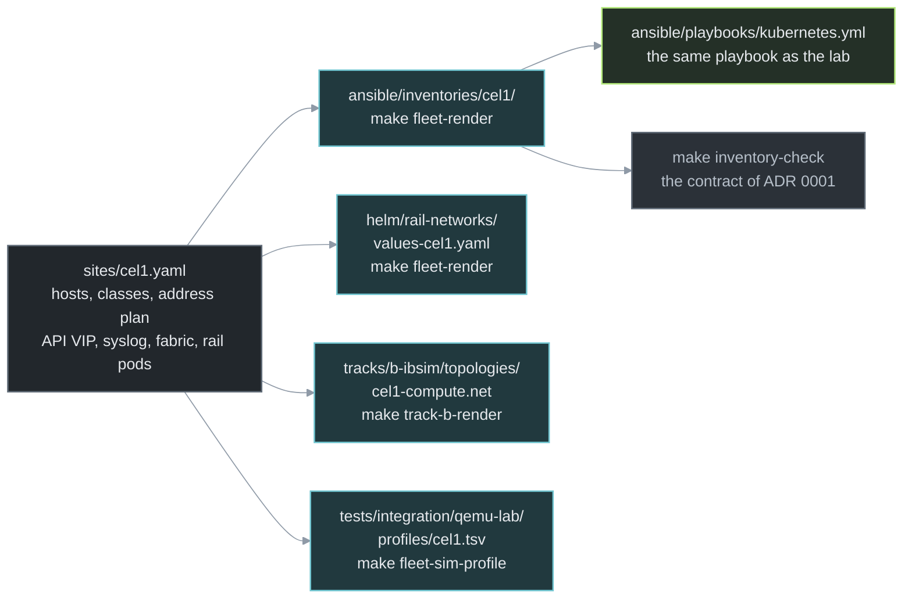

import Excerpt from '../../../components/Excerpt.astro';

cel1 is a region that does not exist. Its hosts, addresses, interface names and switch names are all invented. It exists so that the lab can run the code a real GPU region would use. One file describes it, generators turn that file into everything else, and offline checks prove the generated files still match it.

## One source, many outputs

| Class | Hosts | Count | Ports |
|---|---|---:|---|
| `control_plane` | `cel1-cp-01` to `03` | 3 | `mgmt0` |
| `dgx_b200` | `cel1-dgx-01` to `08` | 8 | `mgmt0`, `stor0`, `stor1`, `rail0` to `rail7` |
| `pcie_gpu` | `cel1-pcie-01`, `02` | 2 | `mgmt0` |

The address plan gives each network one range: management `10.140.0.0/24` with the API VIP at `.10` and syslog at `.5`, two storage networks, eight compute rails `10.142.0.0/24` to `10.142.7.0/24`, a pod range on each rail `10.143.0.0/24` to `10.143.7.0/24`, pods `10.160.0.0/16` and Services `10.170.0.0/16`. None of them overlaps another or the lab address plan. Every host lists all its addresses, and no rule computes an address from a host number, so the duplicate and range checks do real work. The [rail-optimized compute fabric](/concepts/infiniband-management/) is an explicit cable list of 128 links ([fleet runbook](/docs/fleet/) section 2).

## The inventory contract

The lab and cel1 run the same playbook `ansible/playbooks/kubernetes.yml` and the same roles `containerd` and `kubeadm`. They differ only in inventory variables, and the playbooks read only the groups and variables of the contract in [ADR 0001](/docs/adr/0001-kubernetes-stack/) section 4.

| Name | Kind | Meaning |
|---|---|---|
| `kube_control_plane`, `kube_node`, `k8s_cluster` | groups | Control planes, workers, and their union. The first control plane runs `kubeadm init` |
| `rfl_inventory` | string | `lab` or `cel1`, also the Helm environment name. The playbook rejects a host without it |
| `k8s_node_ip` | per-host IPv4 | The address kubelet registers, on the management network |
| `k8s_api_endpoint`, `k8s_api_port` | address, integer | The `controlPlaneEndpoint` of kubeadm. Port 6443 by default |
| `k8s_api_vip`, `k8s_api_vip_interface` | IPv4 or absent, NIC | The kube-vip address. Required with two or more control planes, and equal to `k8s_api_endpoint` |
| `k8s_pod_cidr`, `k8s_service_cidr` | CIDR | kubeadm and Cilium IPAM get the same value |
| `k8s_kube_proxy` | boolean | When false, kubeadm installs no kube-proxy and Cilium replaces it |
| `k8s_control_plane_schedulable` | per-host boolean | When true, that control plane gets no control-plane taint |
| `k8s_node_labels` | per-host map | The labels kubelet adds when it registers. Never the `kubernetes.io` or `k8s.io` prefixes |
| `k8s_container_runtime_default` | per-host `runc` or `nvidia` | With `nvidia`, containerd's default runtime becomes `/usr/bin/nvidia-container-runtime` |
| `k8s_admin_kubeconfig` | control node path | Where the admin kubeconfig lands, mode 0600 |

`make inventory-check INVENTORY=<lab|cel1|dir>` checks an inventory against the contract offline. Another site keeps its own inventory outside the repository, follows the same contract, and uses the same playbook ([fleet runbook](/docs/fleet/)).

## The offline checks

`make fleet-check` runs every check that needs no guest: the site model, the rendered inventory, the simulation profile, the contract, the Helm values keys, and the rendered charts through kubeconform. This is its output in the gates of the cel1 simulation.

<Excerpt id="cel1-fleet-check" />

`make track-b-render-check` adds the ibsim net file. Each generator also has a `--check` mode that fails when the committed file differs from what the model renders, so a hand edit of a generated file fails the gate.

## Pod networks on the rails

[ADR 0007](/docs/adr/0007-cel1-ipoib-pod-networks/) decides how a pod on a DGX node reaches the eight InfiniBand rails. Cilium stays the primary network on `mgmt0`. Multus adds one IPoIB interface per rail, `rail0` to `rail7` in the pod as on the host. The NVIDIA Network Operator runs only the RDMA shared device plugin, nv-ipam and ipoib-cni. NCCL keeps using verbs on `mlx5_0` to `mlx5_7`, and the IPoIB interfaces carry RDMA CM and IP.

The model holds the pod range of each rail and a `kubernetes.rail_networks` section: the namespace `rdma-jobs`, the selector of the DGX class and 16 addresses per node per rail. `make fleet-render` writes the values of the repo-local chart `helm/rail-networks/chart`, which renders the policy, one `IPoIBNetwork` and one nv-ipam `IPPool` per rail. `make addons-template` validates them against schemas converted from the operator's CRDs. The scenario [cel1-rail-networks](/labs/cel1/cel1-rail-networks/) checks the installed result on the simulation. Its rails are virtio Ethernet, so no IPoIB interface or RDMA device can exist there, and the data path needs DGX hardware ([fleet runbook](/docs/fleet/) section 14).

## The gates in front of cel1

The targets that would change cel1 hosts refuse without `CONFIRM=cel1` and a connection inventory, and they refuse any host, kubeconfig server or `rfl_kubeconfig_server` that is not on 127.0.0.1. Only the simulation's guests sit behind such forwards. `make addons-template ENV=cel1` is offline and allowed. The [cel1 simulation](/labs/cel1/cel1-sim-baseline/) is the one place the fleet targets ran, against guests.
