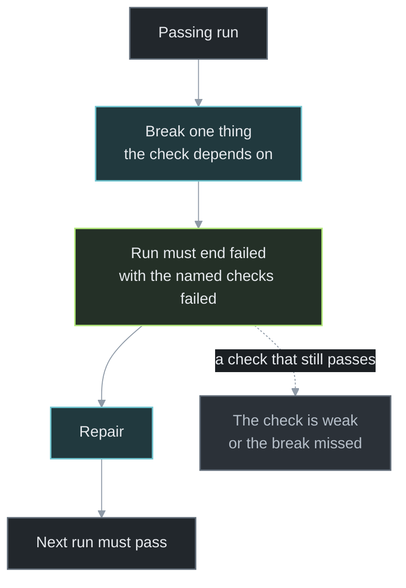

import Excerpt from '../../../components/Excerpt.astro';

A check that has only ever passed proves nothing. It might test the wrong thing, read a file that is always empty, or compare a value with itself. So every check of every scenario in the lab was broken once on purpose: the thing it checks was damaged, the run had to end `failed` with exactly that check failed, and the next run after the repair had to pass.

## The method

A break may fail more checks than it targets, and the records say so when it does. A check that keeps passing on a break is either correct, because the break does not touch what it checks, or a defect. The records name which, for example `routes-shortest` passing in every Track B break run, because each route still leaves by a port one hop closer to its endpoint.

## How each track breaks itself

| Track | Mechanism | Where |
|---|---|---|
| A, VM scenarios | Faults applied in the guests by hand or by the acceptance script: a link down, `netem loss 100%`, a disabled unit | `tests/integration/qemu-lab/acceptance.sh`, runs `20261115T022358Z`, `20261115T022449Z` and `20261115T022539Z` |
| A, cluster scenarios | `tests/integration/qemu-lab/breaks-k8s-rdma.sh` runs each break, requires the named checks failed, repairs, and requires the next run to pass | The series under `.lab/breaks-m3/`, [verification](/docs/verification/) section 3 |
| B | `python -m ibsim run --break` removes one link from the net file the simulator gets, while every expectation keeps the full topology. `make track-b-breaks` fails unless every run ends `failed` | [ADR 0005](/docs/adr/0005-track-b-fabric-simulation/) section 1.6, run `20261116T194838Z` |
| C | `python -m ns3 run --break <name>` applies one entry of the break table in `scripts/ns3/run.py`. `make track-c-breaks` fails unless each run exits 1 with all of the entry's checks failed, and a unit test asserts the breaks together target every check | `BREAKS` in `scripts/ns3/run.py`, runs `20261116T200636Z` to `20261116T201314Z` |
| cel1 | rsyslog stopped on one DGX guest, then `make fleet-rsyslog` as the repair | `tests/integration/qemu-lab/acceptance-cel1.sh`, runs `20261116T202754Z` and `20261116T203232Z` |

The Track A break script writes a pair table per series. This is the third series of the pod scenarios, `.lab/breaks-m3/20261116T000255Z`.

<Excerpt id="repo-break-pairs" />

## Breaks of the tests themselves

The unit tests break their own verdicts too. A mutation check of the Track B tests changed one line in each of eight places, such as the route direction, duplicate LIDs, link symmetry and the QEMU flag allowlist, and each change failed at least one test (`.lab/evidence/m4/unit-mutations.txt`). The tests of Track C break each incast verdict on fixtures captured from real runs.

This site applies the same method to itself. `scripts/verify-dist.mjs` runs after every build and fails when a page lacks a declared check, a make target or a copied document. Its own unit tests feed it a scenario that gained a check the site does not show, and require it to fail.

## Every lab lists its breaks

Each lab page has a "Break it yourself" section with the breaks of its scenario, the checks that failed, and the broken and repaired runs. Where no break ran for a scenario, the page says so and points to the scenario whose breaks cover the same check code.
