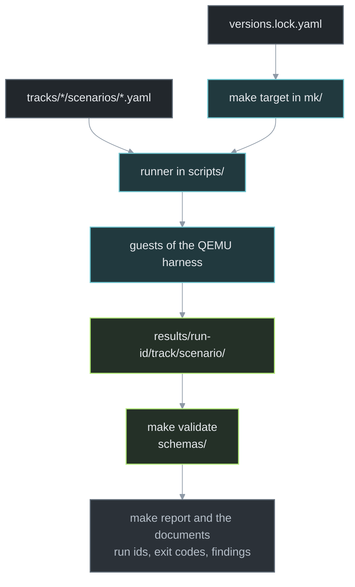

The repository holds the code of every track, the result contract they share, and the records of what ran. Results and logs stay out of git. Only the records and their run ids are committed.

| Path | Contents |
|---|---|
| `ansible/` | Inventories for `lab` and `cel1`, playbooks, and the roles of the shared stack (`containerd`, `kubeadm`) and the lab (`preflight`, `common`, `network`, `rxe`, `rdma_tools`, `cni_layout`, `rsyslog_client`) |
| `helm/` | `releases.yaml`, the Helm releases in install order, values per environment, and the repo-local Multus chart |
| `images/` | The pinned Track B image, the Track C ns-3 image with its one patch, and the RDMA test image, all built inside a harness guest |
| `sites/` | Site models. `sites/cel1.yaml` is the single source of cel1 |
| `scripts/` | The result contract `rfl`, scenario runners, doctor, the addons runner, fleet and inventory checks, and the Track B and Track C runners |
| `tracks/` | Scenario specs, their configuration, the Track B topologies, the Track C driver and the guest scripts |
| `tests/` | Unit tests, fixtures captured from real runs, and the QEMU harness under `tests/integration/qemu-lab/` |
| `schemas/` | JSON schemas of scenario specs, run manifests, metrics and the version lock |
| `versions.lock.yaml` | Every pinned version and checksum, grouped in scopes per part of the lab |
| `docs/` | The runbook, the verification record, ADRs, the cel1 runbook, VMware setup and troubleshooting |
| `mk/` | The make targets of each area, included by `Makefile` |
| `.site/` | This site |

## How a run flows through it

## What stays local

| Path | Why it is not in git |
|---|---|
| `results/` | Run directories with raw captures and logs. The documents cite their run ids |
| `.lab/` | Guest disks, cloud-init seeds, SSH keys, the kubeconfig and the harness logs, and in `.lab/evidence/` copies of the evidence the documents cite by path |
| `.tools/` | The pinned helm and kubeconform from `make tools`, and the charts they render |
| `.venv/` | The pinned Python tooling from `make venv` |

So a path under `.lab/` or `results/` on this site is shown as code. It names a file that exists only on the machine that ran the lab.

## The pages of this section

- [Results contract](/repository/results-contract/): scenario specs, checks, evidence and `make validate`.
- [Version lock](/repository/version-lock/): `versions.lock.yaml`, its scopes and `make versions`.
- [QEMU harness](/repository/qemu-harness/): profiles, the user-space switch and cable, and the port forwards.
- [cel1 site model](/repository/cel1-site-model/): `sites/cel1.yaml`, the rendered inventory and the inventory contract.
- [Deliberate breaks](/repository/deliberate-breaks/): how every check was shown to fail.
