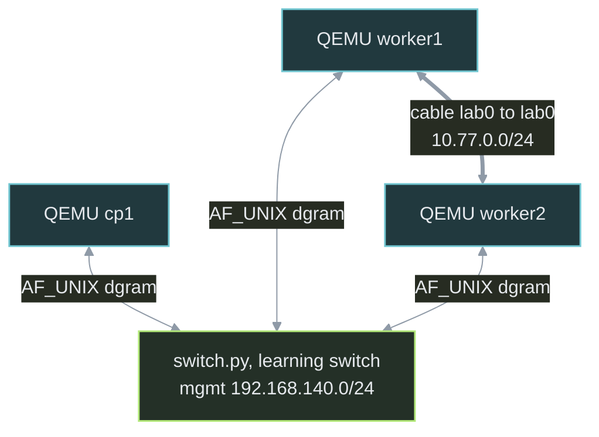

import Excerpt from '../../../components/Excerpt.astro';
import RepoFile from '../../../components/RepoFile.astro';

Every guest of the lab is an unprivileged QEMU process with KVM, started by `tests/integration/qemu-lab/lab.sh`. No libvirt network or domain exists, no tap device is created and no sudo is needed. The lab networks are AF_UNIX datagram sockets on the host, so their frames cannot leave it.

## Profiles

A profile is one TSV file under `tests/integration/qemu-lab/profiles/`. Each line is a guest with its SSH port, vCPUs, memory, disk and NICs. Header lines name the inventory, the switched networks and any extra QEMU flags. This is the lab profile.

<RepoFile path="tests/integration/qemu-lab/profiles/lab.tsv" />

| NIC field | Meaning |
|---|---|
| `net=user` | QEMU user networking. DHCP, the default route, SSH and package downloads |
| `net=switch:<name>` | A port of the named user-space switch |
| `net=cable:<peer>` | One end of a direct cable to the peer guest |
| `name=<nic>` | cloud-init renames the NIC at first boot, matched by MAC |
| `vars=<var>` | The harness writes the NIC's name into this inventory variable |
| `ip=<var>` | The NIC gets the address the inventory variable holds |
| `fwd=<host>:<guest>` | A TCP forward from 127.0.0.1 on the host to the guest |

| Profile | Guests | Used by |
|---|---|---|
| `lab.tsv` | `cp1`, `worker1`, `worker2` | Track A |
| `ha.tsv` | `ha-cp1` to `ha-cp3`, `ha-w1` | [k8s-ha-vip](/labs/track-a/k8s-ha-vip/) |
| `ibsim.tsv` | `ibsim1`, with `-no-reboot` | Track B and the RDMA test image build |
| `ns3.tsv` | `ns3sim1`, with `-no-reboot` | Track C |
| `cel1.tsv` | 13 cel1 hosts and `cel1-sim-syslog`, with `-no-reboot` | the [cel1 simulation](/labs/cel1/cel1-sim-baseline/). `make fleet-sim-profile` writes it from `sites/cel1.yaml` |

`make lab-up LAB_PROFILE=<name>` boots a profile, and `LAB_DIR=<dir>` puts its disks elsewhere. The guests boot from qcow2 overlays on one base cloud image, `noble/20261017`, pinned by sha256 as `lab.guest_image`, a value taken from Ubuntu's signed `SHA256SUMS`.

## The switch and the cable

The management network is `switch.py`, a Python learning switch that moves frames between guests over AF_UNIX datagram sockets. It runs with user privileges and no capabilities. The lab network is a direct cable, two AF_UNIX sockets that join the lab NICs of `worker1` and `worker2` with `-netdev dgram`. The Kubernetes acceptance checks both in its step `harness-sockets`: only `u_dgr` sockets under `.lab/net/`, and a switch with no capability at all.

<Excerpt id="repo-harness-sockets" />

The cable passes any MAC address, so the macvlan children of [k8s-multus-net1](/labs/track-a/k8s-multus-net1/) cross it. The cel1 simulation uses one switch per site network, 11 in all, and 188 `u_dgr` sockets ([fleet](/docs/fleet/) section 13).

## Port forwards, the only way in

Each guest's user NIC forwards its SSH port from 127.0.0.1 on the host. Nothing else reaches a guest. Ansible, the runners and `kubectl` go through these forwards.

| Forward | Purpose |
|---|---|
| `127.0.0.1:22211` to `22213` | SSH to `cp1`, `worker1`, `worker2` |
| `127.0.0.1:22643` to `cp1:6443` | The Kubernetes API. `make k8s` writes this address into `.lab/kubeconfig` with `tls-server-name: kubernetes` |
| `127.0.0.1:22231`, `22241` | SSH to `ibsim1` and `ns3sim1` |
| `127.0.0.1:22340` to `cel1-cp-01:6443` | The cel1 API in the simulation |

The cel1 addresses are invented, so the host never connects to them directly. The fleet targets refuse any host or kubeconfig server that is not on 127.0.0.1.

## Override inventory

NIC names differ per hypervisor, so they are not in the tracked inventory. At `lab-up` the harness finds each NIC by MAC inside the guest and writes the names into `.lab/inventory.yml`, which every lab target passes as a second `-i` after `ansible/inventories/lab/`. When a profile declares a name, such as `lab0`, the first boot renames the NIC to it.

## How it differs from the VMware design

| Item | VMware design | QEMU harness |
|---|---|---|
| Management network | One NAT VMnet carries internet, SSH and the API | Split in two: the user NIC for SSH and downloads, the switch for Kubernetes and VXLAN |
| RDMA lab network | A host-only VMnet | The direct dgram cable |
| Default route and SSH | Management NIC | User NIC, named by `lab_uplink_nic` |
| API from the host | `192.168.140.11:6443` through the NAT VMnet | The forward `127.0.0.1:22643` |
| Power failure | Power off the VM | `lab.sh kill` sends SIGKILL to QEMU |

The split default route matters. It is the condition behind the Cilium API defect of [ADR 0001](/docs/adr/0001-kubernetes-stack/) section 9. The VMware path is in [setup-vmware](/docs/setup-vmware/), whose section 8 lists every difference from the harness, and is not verified on this host.
