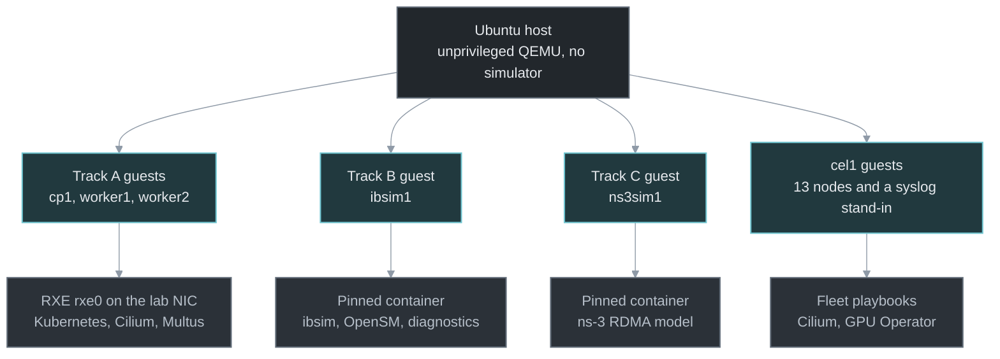

The lab answers three questions on one Ubuntu host that has no HCA, no InfiniBand switch and no GPU. How do RDMA programs run over plain Ethernet, and how do Kubernetes workloads reach them? How does a subnet manager discover a fabric, assign LIDs and react to a link fault? How do PFC, ECN and DCQCN settings change queues, rates and flow completion?

Each question gets its own track with its own tools and its own definition of success. The same Ansible and kubeadm code that builds the lab cluster also describes `cel1`, an invented GPU region, so every lab run exercises that code.

## The pieces

The tracks share the repository, the result format and the version lock. They do not share a data path. The virtual HCAs of Track B are not PCI devices of the Track A guests, and the switch of the Track C model is not wired into the Track A lab network.

| Track | Question | Stack | Result kind |
|---|---|---|---|
| A. Kubernetes and Soft-RoCE | How do RDMA programs run over plain Ethernet, and how do Kubernetes workloads reach them? | QEMU guests, Ansible, kubeadm, containerd, Cilium by Helm, Multus, Whereabouts, RXE | `software-rdma-measurement`, `software-cluster-test` |
| B. InfiniBand management | How does a subnet manager discover a fabric, assign LIDs and react to link faults? | ibsim, OpenSM, infiniband-diags in a pinned image | `ib-management-simulation` |
| C. RoCE congestion control | How do PFC, ECN and DCQCN settings change queues, rates and flow completion? | The ns-3-alibabacloud model built through SimAI, in a pinned image | `packet-model-simulation` |

The result kind is a field of every scenario spec and every `metrics.json`, so a software measurement, a management simulation and a model result never pass for one another. `make report` tallies required and optional runs apart and prints the result kind of each run.

## What the lab does not claim

These lines come from the repository README and hold for every page of this site.

- **IPoIB.** RXE runs over Ethernet and ibsim simulates management datagrams. Neither creates the IPoIB data path, so nothing here validates IPoIB. The cel1 rail networks are checked only up to ipoib-cni refusing an Ethernet rail.
- **HCA performance.** RXE numbers are software results of one host, kernel and guest combination. They say nothing about offload, InfiniBand or RoCE hardware latency, or 200, 400 or 800 Gb/s throughput.
- **Lossless switching.** PFC, ECN and DCQCN results in Track C are the behavior of the simulation model, not of a real switch or of the hypervisor's virtual switch.
- **GPU and NCCL performance.** GPUDirect RDMA, NVLink and NCCL are out of scope. Nothing in this repository has run against GPU hardware.

## How each experiment is recorded

Every scenario declares its checks in a spec file. A run writes a result directory with a manifest, logs, raw captures and metrics, and its status comes only from the recorded checks. A passed check must point at evidence in the run directory. The lab pages and the repository documents keep the run ids, the exit codes and the findings. The [results contract](/repository/results-contract/) page explains the format.

Every lab check was also broken once on purpose. A check that has never failed proves nothing, so each lab page lists the [deliberate breaks](/repository/deliberate-breaks/) that made its checks fail and the runs that recorded them.

## Status

The MVP is complete. One run of `tests/integration/qemu-lab/acceptance-all.sh`, `20261116T190004Z` on 2026-11-16, passed every required experiment again from wiped guests: 15 of 15 required and 4 of 4 optional scenarios. The [verification](/docs/verification/) document lists those runs and the evidence for each item of the MVP checklist. Each lab page names the runs its figures come from.

| Part | What it proved | Lab pages |
|---|---|---|
| RXE between VMs | rping and RDMA Read, Write and Send between two workers over RDMA CM, RoCEv2 frames on the lab NIC only, the device back after a reboot | [vm-rxe-baseline](/labs/track-a/vm-rxe-baseline/), [vm-rxe-reboot](/labs/track-a/vm-rxe-reboot/), [vm-rxe-rerun](/labs/track-a/vm-rxe-rerun/) |
| Kubernetes | Kubernetes v1.36.6 with Cilium 1.20.4 by Helm. Three control planes behind a kube-vip address answered again 6.0 s after the address holder lost power | [k8s-baseline](/labs/track-a/k8s-baseline/), [k8s-ha-vip](/labs/track-a/k8s-ha-vip/) |
| hostNetwork RDMA and Multus | The RXE tests between hostNetwork pods, and `net1` from Whereabouts beside Cilium through pod recreation and a worker reboot | [k8s-hostnet-rdma](/labs/track-a/k8s-hostnet-rdma/), [k8s-multus-net1](/labs/track-a/k8s-multus-net1/) |
| ibsim and OpenSM | B-01 to B-04 inside the Track B guest, each failing on its deliberate break | [B-01](/labs/track-b/b-01/) to [B-04](/labs/track-b/b-04/) |
| cel1 simulation | The cel1 cluster on 13 guests from wiped disks with the fleet targets | [cel1-sim-baseline](/labs/cel1/cel1-sim-baseline/) |
| cel1 rail networks, after the MVP run | Multus beside Cilium and the Network Operator's device plugin, nv-ipam and ipoib-cni on the 8 DGX guests, all from the site model, in acceptance run `20261118T012729Z` | [cel1-rail-networks](/labs/cel1/cel1-rail-networks/) |
| ns-3 baseline | The model builds in a pinned image, its smoke test repeats byte for byte, and one flow completes 7.43% above its payload bound with the gap explained | [c-01-example](/labs/track-c/c-01-example/), [c-02-single-flow](/labs/track-c/c-02-single-flow/) |
| Congestion profiles | Incast under four profiles, three workloads and five seeds, with each feature's activation read from the model's counters | [c-03](/labs/track-c/c-03-incast-simultaneous/) to [c-06](/labs/track-c/c-06-sensitivity-kmin/) |
