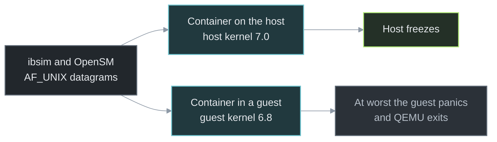

The lab runs kernels, simulators and a Kubernetes cluster on the same machine you work on. A few rules keep a fault inside a guest from reaching that machine. Each rule below exists because of something that happened or could happen, and each is enforced by code, not only by this page.

## The host kernel AppArmor bug

On 2026-11-15, `ibnetdiscover` and `opensm` running inside host containers froze the host three times. The cause is a bug in the Ubuntu `7.0.0-42` and `7.0.0-43` kernels. A process that AppArmor confines hits a NULL dereference when it calls `write()` on a connected AF_UNIX datagram socket. ibsim and libumad2sim use exactly that socket, and Docker confines every container with the `docker-default` profile. The upstream fix is "apparmor: fix NULL ctx->peer derefs in unix socket ctx updates".

Containers share the host kernel, so a host kernel bug freezes the whole host even when it fires inside a container. Inside a guest, the same bug freezes only that guest, because the guest runs its own kernel.



So ADR 0002 decides where each track runs ([ADR 0002](/docs/adr/0002-execution-environments/)).

| Target | Runs in | Why |
|---|---|---|
| Track A and the cel1 simulation | QEMU guests | RXE is a kernel device. Two workers are separate only when each guest has its own kernel and RDMA stack |
| Track B and Track C | A pinned image in the container runtime of a dedicated QEMU guest | One reproducible container per track, isolated from the host kernel |
| Offline checks, such as lint, rendering and kubeconform | Host processes | No simulator that uses these sockets runs |

The Track B and Track C guests set `kernel.panic_on_oops=1` and boot QEMU with `-no-reboot`. A panic inside them ends the QEMU process and leaves the console in `serial.log`. After every Track B and Track C run of record, a search of that log for `oops`, `BUG:` or `panic` found nothing.

## How the host refuses

The scripts that start a simulator check where they run. `tracks/b-ibsim/scripts/guest.sh` and `tracks/c-ns3/scripts/guest.sh` refuse unless the guest marker `/etc/rfl/track-b-guest` or `/etc/rfl/track-c-guest` exists, and the image entry points refuse without a read-only marker mount that only `guest.sh` adds. Every subcommand was run on the host with stubs first on `PATH`.

```text
refusing to run: /etc/rfl/track-b-guest is missing, so this machine is not the Track B guest. ... On the host, run make track-b.
```

That line is shortened from `.lab/evidence/m4/host-refusal.log`. Every refused command exited 2, and no call reached a stub. `tests/unit/test_ibsim_host_refusal.py` and `tests/unit/test_ns3_host_refusal.py` repeat the refusal on every `make test`. The checks `host-untouched` of Track B and Track C scan the host process list and `docker ps` at the start and the end of every run.

## Rules every run keeps

- No sudo and no `modprobe` on the host. RXE devices exist only inside guests.
- No container with `--privileged`, `--net=host` or added capabilities, on the host or in a guest. The Track B and Track C containers run with `--network none --cap-drop ALL --security-opt no-new-privileges --read-only` as UID 10001.
- No libvirt network or domain. Guests run as unprivileged QEMU processes whose network frames never leave the host. The lab switch and cable are AF_UNIX datagram sockets, and the switch process has no capabilities (`CapEff: 0000000000000000`).
- The exception that the lab RDMA pods need. [k8s-hostnet-rdma](/labs/track-a/k8s-hostnet-rdma/) runs its two pods with `privileged: true` inside the lab cluster, because no narrower profile opens the device. The scenario spec declares it, and every run proves the narrower profiles still fail.

## Confirmation gates

| Target | Refuses without | Why |
|---|---|---|
| `make reset-lab` | `CONFIRM=lab` | It deletes `rxe0`, the unit and the lab address on the workers |
| `make fleet-k8s`, `fleet-addons`, `fleet-rsyslog`, `fleet-sim-stand-ins` | `CONFIRM=cel1` and `FLEET_CONNECT=<simulation inventory>` | They change cel1 hosts. cel1 addresses are invented, so the host never connects to them directly |

The fleet targets also refuse any host, kubeconfig server or `rfl_kubeconfig_server` that is not on 127.0.0.1. The cel1 simulation reaches its guests only through 127.0.0.1 port forwards. Under strace, ten refusals made no IPv4 or IPv6 call (`.lab/evidence/cel1-sim/refusals-final.log`).

`make cleanup RUN=<run-id>` stops only the processes of that run and deletes only its guest files. It never deletes the device or a guest. In `tests/integration/qemu-lab/acceptance.sh` a decoy process of another run survived it (steps 28 to 35 of `.lab/acceptance/20261115T022117Z`).
