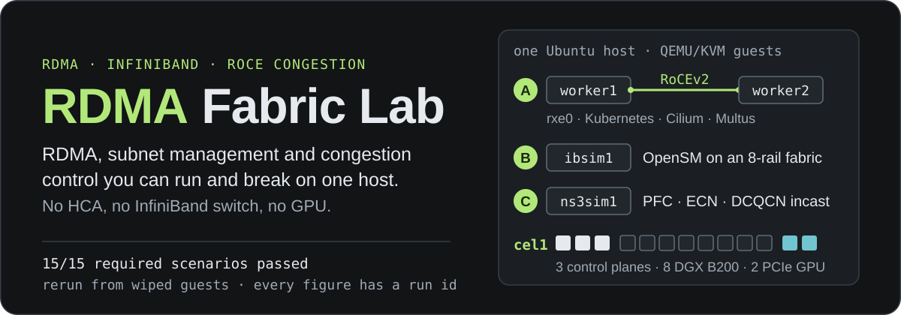
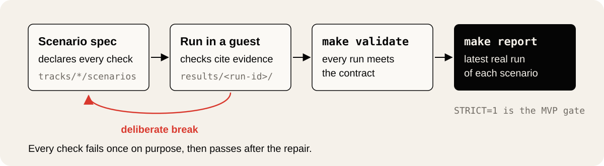

<p align="center">
  
</p>

<p align="center">
  <a href="docs/runbook.md">Runbook</a> ·
  <a href="docs/verification.md">Verification</a> ·
  <a href="https://rdma-fabric.restack.tech/">Learning site</a> ·
  <a href="docs/adr/">Decisions</a> ·
  <a href="LICENSE">MIT</a>
</p>

RDMA Fabric Lab runs RDMA, InfiniBand management and RoCE congestion-control experiments on one Ubuntu host with KVM. Soft-RoCE carries real RDMA between QEMU guests, ibsim stands in for an InfiniBand fabric under OpenSM, and an ns-3 model plays out PFC, ECN and DCQCN. Every experiment declares its checks up front, proves each one with evidence from a recorded run, and has a deliberate break that must make it fail.

## Proof

The last full rerun started from wiped guests and ran every required experiment, one guest profile at a time, in 100.5 minutes (`acceptance-all.sh` run `20261116T190004Z`, 2026-11-16). Its closing report:

```text
$ make report STRICT=1
...
required (MVP): 15 of 15 scenarios passed
optional: 4 of 4 scenarios passed
not counted: 44 deliberate break runs, 19 unfinished runs, 281 older runs
invalid: 0
```

What the latest runs showed:

- **A. Soft-RoCE.** rping and RDMA Read, Write and Send over RDMA CM between two worker VMs, with RoCEv2 frames on the lab NIC only. Read ran at 1.91 Gb/s, a software figure of this host. Run `20261116T192132Z`.
- **A. Kubernetes.** The same RDMA tests between hostNetwork pods, and `net1` from Multus and Whereabouts beside Cilium through pod recreation and a worker reboot. Runs `20261116T192258Z` and `20261116T192350Z`.
- **B. InfiniBand management.** OpenSM discovers each fabric, assigns unique LIDs, drops and restores an endpoint, and routes around a failed leaf-to-spine link on the cel1 rail fabric. Run `20261116T194712Z`.
- **C. RoCE congestion control.** One 1 MB flow completes in 88092 ns, 7.43% above its payload bound, with the gap explained to the nanosecond. Under an 8-to-1 incast, PFC alone kept every packet and reached 94.7 Gb/s of goodput. Run `20261116T200409Z`.
- **cel1.** The fleet code builds an invented GPU region as 13 guests: 3 control planes, 8 DGX B200 and 2 PCIe GPU servers. Run `20261116T203232Z`.
- **cel1 in NetBox.** The site model exported to NetBox v4.7.5 in its own guest: 1142 objects, drift made by hand named exactly and undone, and objects without the managed tag left alone (ADR 0008).
- **cel1 rail networks.** Multus beside Cilium, and the NVIDIA Network Operator's RDMA device plugin, nv-ipam and ipoib-cni on the 8 DGX guests, all rendered from the site model. The rails carry Ethernet, so the plugin exposes no device and ipoib-cni refuses every rail, as designed (ADR 0007). Run `20261118T014617Z`.

## How a result is proved

<p align="center">
  
</p>

A run's status comes only from its recorded checks, and a passed check must cite evidence inside its run directory. `make report` groups scenarios by result kind, so an RXE measurement, a cluster test, the InfiniBand management simulation and the packet model never stand in for each other. `docs/verification.md` lists the runs of record and the evidence for each item of the MVP checklist.

## Three tracks and one region

- **A. Kubernetes and Soft-RoCE.** How do RDMA programs run over plain Ethernet, and how do Kubernetes pods reach them? Three QEMU guests, `cp1`, `worker1` and `worker2`, with RXE on a direct lab link, built by Ansible and kubeadm, with Cilium, Multus and Whereabouts.
- **B. InfiniBand management.** How does a subnet manager discover a fabric, assign LIDs and react to link faults? A pinned ibsim, OpenSM and infiniband-diags image in its own guest.
- **C. RoCE congestion control.** How do PFC, ECN and DCQCN change queues, rates and flow completion? A pinned ns-3-alibabacloud image in its own guest.
- **cel1.** Does the same Ansible and kubeadm code build a GPU region? 13 guests built from `sites/cel1.yaml`, every name and address invented.

## What it does not claim

- **HCA or switch performance.** RXE figures are software results of one host and guest pair. They say nothing about offload or 200, 400 or 800 Gb/s hardware.
- **IPoIB.** RXE runs over Ethernet and ibsim simulates management datagrams, so nothing here exercises an IPoIB data path. The cel1 rail networks are checked up to ipoib-cni refusing an Ethernet rail.
- **Lossless switching.** Track C results are what one packet model computes. In that model, PFC off means hosts ignore PAUSE while the switch still sends it.
- **GPU or NCCL behavior.** Nothing in this repository has run against GPU hardware.

## Quick start

You need an Ubuntu 24.04 host with KVM, `/dev/kvm` usable by your user, and `qemu-system-x86_64`, `qemu-img`, `cloud-localds`, `uv`, `make`, `git` and `curl`. The lab needs no sudo. The first experiment needs 3 guests, 10 vCPUs and 16 GiB of memory.

```bash
make venv lint test doctor     # pinned tooling, static checks, unit tests, read-only host check
make lab-up                    # boot cp1, worker1 and worker2 from the pinned cloud image
make bootstrap rxe-up          # locked packages, the lab NIC address, rxe0
make rxe-test                  # RDMA between the workers, recorded under results/
make validate report           # check the run, then show the latest run of each scenario
```

Then the rest of the lab:

```bash
make k8s                                              # kubeadm cluster on the same guests
make addons ENV=lab KUBECONFIG_FILE=.lab/kubeconfig   # Cilium, Multus and Whereabouts by Helm
make rdma-tools-image                                 # build the RDMA test image inside the Track B guest
make lab-down LAB_PROFILE=ibsim                       # stop that builder before anything is measured
make rdma-tools-load track-a                          # load the image on the workers, run every Track A scenario
make lab-down                                         # one guest profile at a time
make track-b lab-down LAB_PROFILE=ibsim               # B-01 to B-04 in the Track B guest
make track-c lab-down LAB_PROFILE=ns3                 # c-01 to c-06 in the Track C guest
```

`tests/integration/qemu-lab/acceptance-all.sh` runs all of it, and the cel1 region, from wiped guests. `docs/runbook.md` gives every step, the guest sizes and the measured durations, and `make cleanup RUN=<run-id>` removes what an interrupted run left.

## Learn

The [learning site](https://rdma-fabric.restack.tech/) teaches the concepts behind each experiment, from verbs and RoCEv2 frames to subnet managers and DCQCN, and gives one page per lab with the commands to run it, what every check proves, real output with its run id, and the deliberate breaks to try. Its source is `.site/`, and `make site-dev` serves it locally.

| Document | What it holds |
|---|---|
| `docs/runbook.md` | From a fresh host to every track, cleanup, recovery and the safety rules |
| `docs/verification.md` | How the lab proves itself, the latest full rerun and the MVP checklist |
| `docs/troubleshooting.md` | Failures seen in every track and the cel1 simulation, with their causes and fixes |
| `docs/adr/` | Why the lab is built this way: the Kubernetes stack, where each track runs, results and breaks, RDMA in pods, the Track B simulation and the Track C model |
| `docs/fleet.md` | The cel1 region and how to apply the code to another site |
| `docs/setup-vmware.md` | The same lab as VMware Workstation guests, not verified on the current host |

## Repository

| Path | Contents |
|---|---|
| `ansible/` | Inventories for `lab` and `cel1`, playbooks, and the roles shared by the lab and the region |
| `helm/` | The Helm releases in install order and their values per environment |
| `tracks/` | Scenario specs, their configuration, the Track B topologies and the Track C driver |
| `scripts/` | The result contract (`rfl`), scenario runners, cleanup, collect, doctor and the fleet checks |
| `images/` | The pinned Track B, Track C and RDMA test images, each built inside a guest |
| `tests/` | Unit tests over output captured from real runs, and the QEMU harness in `tests/integration/qemu-lab/` |
| `sites/`, `schemas/`, `versions.lock.yaml` | The cel1 site model, the JSON schemas, and every pinned version and checksum |

## Safety

- Simulators run only inside guests. Ubuntu kernels 7.0.0-42 and 7.0.0-43 oops in AppArmor when a confined task writes to a connected AF_UNIX datagram socket, which ibsim uses, so a host container froze the host. `docs/adr/0002-execution-environments.md` explains where each track runs.
- Every guest is an unprivileged QEMU process, and its network frames never leave the host.
- `make reset-lab` needs `CONFIRM=lab`, and the targets that change cel1 hosts need `CONFIRM=cel1`.

## License

MIT (`LICENSE`), except `tracks/c-ns3/driver/rfl-star.cc` and `images/ns3/qbb-resume-qp-lookup.patch`, which link to or patch ns-3 and are GPL-2.0-only, as their SPDX lines say. The `rfl-ns3` image built from them holds GPL-2.0 ns-3. Building it locally creates no obligation; distributing the built image carries the GPL-2.0 terms. Two upstream files are carried byte for byte under their Apache-2.0 license: `helm/multus/chart/files/multus-daemonset-thick.yml.upstream` from Multus and `helm/rail-networks/chart/crds/nv-ipam.nvidia.com_ippools.yaml` from the NVIDIA Network Operator.
