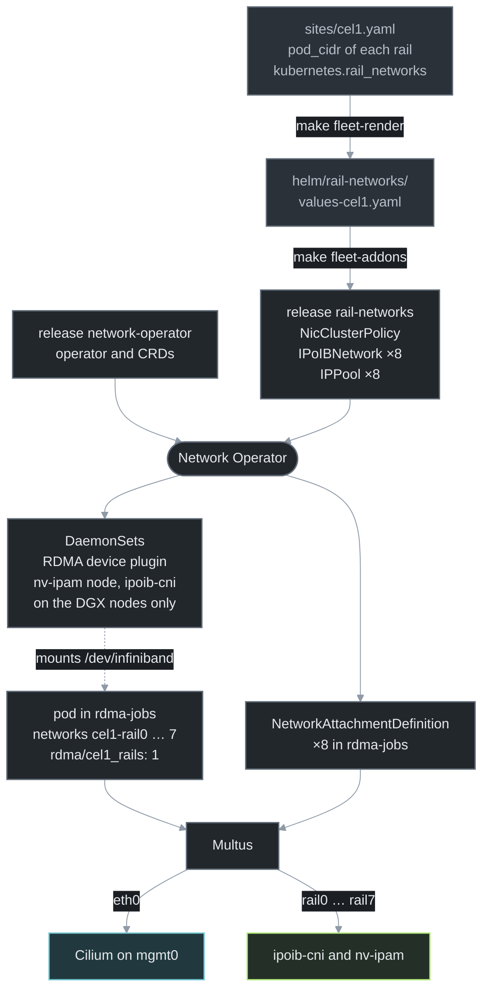

# ADR 0007: Pod networks on the cel1 InfiniBand rails

> Status: accepted, 2026-11-18, with the decisions of section 6. Phase 1, the offline part, and phase 2, the control plane on the cel1 simulation, are done (`docs/fleet.md` section 14). Section 5 lists what each phase proves and what only hardware can prove, and section 5.1 what phase 2 found.

cel1 runs Cilium on the management port and gives pods no path to the eight InfiniBand rails of the DGX B200 nodes (`docs/fleet.md` section 5). This ADR decides how a pod on a DGX node gets those rails: Cilium stays the primary network, Multus adds one IPoIB interface per rail, and the NVIDIA Network Operator supplies the RDMA device plugin, the IPoIB CNI and the address pools. It sits on the shared stack of `docs/adr/0001-kubernetes-stack.md`, which left the Network Operator and IPoIB out of scope (section 6), and reuses the CNI layout that `docs/adr/0004-track-a-pods-and-net1.md` proved in the lab.

The cel1 simulation cannot run any of the data path. Its rails are virtio Ethernet, and IPoIB attaches only to a port whose link layer is InfiniBand, so no guest of this repository can create an IPoIB interface, with or without RXE.


The settings reach a pod this way. Every name, interface and range starts in the site model.



## 1. Decision

1. **Cilium stays the only primary CNI, on `mgmt0`.** Every pod keeps `eth0` from Cilium, and Services, NetworkPolicy, DNS and the NCCL bootstrap stay on it. `devices: mgmt0` does not change, so the eBPF datapath never attaches to a rail. `helm/cilium/values-cel1.yaml` gains the two keys of ADR 0004 section 1.4, `cni.confPath: /etc/cni/multus/net.d` and `cni.exclusive: false`. cel1 sets neither today, and the chart's default `cni.exclusive: true` would rename every other CNI file the agent can see.
2. **Multus comes from the repository's chart, and nothing else installs it.** The `multus` release in `helm/releases.yaml` adds `cel1` to its environments, with a `helm/multus/values-cel1.yaml` that sets `daemonConfig.multusAutoconfigDir: /etc/cni/multus/net.d` as the lab does. The NicClusterPolicy carries no `secondaryNetwork.multus`. A cel1 cluster built before this change needs the migration of ADR 0004 section 2.4 once, `make fleet-cni-migrate`. Whereabouts stays lab only.
3. **The Network Operator installs only three components.** Chart `network-operator` 26.7.1 from `https://helm.ngc.nvidia.com/nvidia` becomes a cel1 release, with `nfd.enabled: false`. The chart creates no NicClusterPolicy by default, so the repository renders one from `sites/cel1.yaml` and applies it as a custom resource. It holds `rdmaSharedDevicePlugin`, `nvIpam` and `secondaryNetwork.ipoib`, each at version `network-operator-v26.7.1` of its image in `nvcr.io/nvidia/mellanox` as in the operator's example policy, pinned by digest in the lock, and a `nodeAffinity` on `rfl.example/node-class In [dgx-b200]`. It leaves out the following.
   - `ofedDriver`. The host driver comes with DGX OS (section 6, decision 1).
   - `secondaryNetwork.multus`. Item 2 explains why.
   - `secondaryNetwork.cniPlugins`. The `containerd` role already installs the locked CNI plugins v1.10.0 into `/opt/cni/bin` (ADR 0001 section 7). A second copier into the same directory would break that lock.

   The operator schedules the device plugin only on nodes that NFD labels with a Mellanox PCI device (section 5.1).

   The operator chart runs with `upgradeCRDs: false`, so no hook rewrites the NetworkAttachmentDefinition CRD that the multus release owns, and the chart of item 5 carries the IPPool CRD, which the operator would create only after it reconciles the policy (`docs/fleet.md` section 14).
4. **One RDMA resource covers all eight rails.** The device plugin publishes `rdma/cel1_rails` with `"selectors": {"ifNames": ["rail0", …, "rail7"]}` and `"rdmaHcaMax": 16`. The selector matches the netdev names that the site's `.link` files assign (`docs/fleet.md` section 2.2), so the model's interface names are also the selector. A pod that asks for one unit gets the character devices of `mlx5_0` to `mlx5_7`. `rdmaHcaMax` equals the per-node address block of item 6, so a pod that is granted the resource always finds a free address on every rail.
5. **One IPoIBNetwork and one IPPool per rail.** For each rail r the chart `helm/rail-networks/chart` renders, from the values that `make fleet-render` writes, an `IPoIBNetwork` named `cel1-rail<r>` with `master: rail<r>` and IPAM `{"type": "nv-ipam", "poolName": "cel1-rail<r>"}`, and an `IPPool` of the same name. Each has `networkNamespace: rdma-jobs`, and the operator turns it into a NetworkAttachmentDefinition there (section 6, decision 2). ipoib-cni creates an IPoIB child of `rail<r>` and moves it into the pod, so the pod shares the rail's partition, the default one in this phase.
6. **Pod rail addresses come from a new range, `10.143.<r>.0/24`.** Each pool has `subnet: 10.143.<r>.0/24`, `perNodeBlockSize: 16`, no gateway and a `nodeSelector` on the DGX class. Eight DGX nodes take 128 of 254 addresses, which leaves room for seven more nodes. The host rail addresses `10.142.<r>.21`–`28` do not change. The site model gains `networks.rail<r>.pod_cidr`, and the validator checks that each range is disjoint from every other network and from the pod and service ranges, and that the nodes of the class times the block size fit in it.
7. **RDMA pods run without `privileged`.** The device plugin admits the HCA devices to the container's device cgroup, which is the piece Track A lacked (ADR 0004 section 2.1). A pod needs `IPC_LOCK`, the `rdma/cel1_rails` request, the eight networks and the GPUs. `IPC_LOCK` is not among the capabilities that PodSecurity `baseline` allows, so `rdma-jobs` runs at the `privileged` level, while the containers themselves are not privileged.
8. **NCCL keeps verbs and IPoIB carries IP.** NCCL reaches the HCAs through verbs (`NCCL_IB_HCA=mlx5_0,mlx5_1,…,mlx5_7`) and bootstraps over `NCCL_SOCKET_IFNAME=eth0`. It does not need IPoIB on its data path. The IPoIB interfaces serve what needs an IP address on the rail: RDMA CM address resolution (`ib_write_bw -R`, UCX and MPI with rdmacm), and IP tools on the fabric. The network selection annotation names the pod interfaces `rail0` to `rail7`, as on the host, instead of Multus's default `net1` to `net8`.
9. **Isolation on the rails belongs to InfiniBand partitions, not to Cilium.** Cilium NetworkPolicy applies to `eth0` only. A pod on the default partition can reach every other pod and host port on that partition. Isolation between tenants needs P_Key partitions in the subnet manager and, on each host, a P_Key child of `rail<r>` as the IPoIBNetwork master. That is phase 4.

A pod that uses the rails would look like this. Section 5 lists what renders it.

```yaml
metadata:
  namespace: rdma-jobs
  annotations:
    k8s.v1.cni.cncf.io/networks: |
      [{"name": "cel1-rail0", "interface": "rail0"}, {"name": "cel1-rail1", "interface": "rail1"},
       {"name": "cel1-rail2", "interface": "rail2"}, {"name": "cel1-rail3", "interface": "rail3"},
       {"name": "cel1-rail4", "interface": "rail4"}, {"name": "cel1-rail5", "interface": "rail5"},
       {"name": "cel1-rail6", "interface": "rail6"}, {"name": "cel1-rail7", "interface": "rail7"}]
spec:
  nodeSelector:
    rfl.example/node-class: dgx-b200
  containers:
    - name: train
      securityContext:
        capabilities: { add: [IPC_LOCK] }
      resources:
        limits:
          nvidia.com/gpu: 8
          rdma/cel1_rails: 1
      env:
        - { name: NCCL_IB_HCA, value: "mlx5_0,mlx5_1,mlx5_2,mlx5_3,mlx5_4,mlx5_5,mlx5_6,mlx5_7" }
        - { name: NCCL_SOCKET_IFNAME, value: eth0 }
```

## 2. Reasons

### 2.1 Why Cilium stays primary and the rails are secondary

- Pod identity, Services, policy and kube-proxy replacement already run on `mgmt0`, and the cel1 simulation proved native routing there (`docs/fleet.md` section 13). Moving the primary network would reopen all of that for no gain on the GPU path.
- An IPoIB interface has a 20-byte hardware address and no Ethernet header. The inference is that Cilium's datapath, written for Ethernet devices, would not attach to one. This was not tried.
- NCCL does not route its collectives through the pod's IP stack. It opens verbs queue pairs on the HCAs, so the rails need devices in the pod more than they need addresses.

### 2.2 Why one Multus

The Multus thick daemon removes `00-multus.conf` when it stops, and a pod created in that window starts with Cilium alone (ADR 0004 section 2.4). The lab's layout closed that window, and `make cni-migrate` moves an old cluster onto it. A second Multus from the operator would manage its own configuration in `/etc/cni/net.d`, the directory that layout keeps for one file. In the operator at tag v26.7.1, `pkg/state/state_multus_cni.go` deletes its Multus objects when `secondaryNetwork.multus` is absent, and the CRD requires no child of `secondaryNetwork`. So leaving the block out is supported, not a workaround.

### 2.3 Why only three operator components

- `ofedDriver`. DGX OS 7.6.0, released 2026-09-14, lists "Inbox OFED 50.0-2" in its ISO component table and supports the DOCA host package through the `doca-ofed` profile (DGX OS 7 release notes). The operator's example policy at v26.7.1 instead builds a driver container, `doca-driver` `doca3.5.0-26.07-0.7.7.0-1`, with drain-based upgrades. Two owners of the `mlx5` modules on one host would fight. `pkg/state/state_ofed.go` deletes the driver objects when the spec has no `ofedDriver`.
- `cniPlugins`. Section 1 item 3. `pkg/state/state_cni_plugins.go` likewise skips an absent block.
- NFD. The GPU Operator chart v26.7.2 already deploys Node Feature Discovery 0.19.0, and its PCI whitelist includes classes `0200` and `0207`, so ConnectX ports in Ethernet or InfiniBand mode get `feature.node.kubernetes.io/pci-15b3.present`. The Network Operator README allows `nfd.enabled=false` when an NFD of v0.13.2 or newer with the NodeFeature API runs. Two NFD instances would run two masters over the same nodes. The policy uses the class label for placement anyway, so NFD labels decide nothing here.

### 2.4 Why the rdma shared device plugin and not SR-IOV

The shared plugin needs no firmware change, no VF count and no fabric manager. Every pod that holds the resource sees all eight HCAs. That matches one training job per DGX node, the common case, and it is why `rdmaHcaMax` can stay small. SR-IOV InfiniBand VFs with `ib-kubernetes` give each pod its own VF, GUID and P_Key, but they need SR-IOV enabled in firmware, the SR-IOV Network Operator and UFM, which `ib-kubernetes` uses to program the fabric. That is the right path for several tenants on one node, and it is listed in section 3.

### 2.5 Why nv-ipam and a separate pod range

- The operator manages nv-ipam, and its NicClusterPolicy API dropped Whereabouts in v26.1.0. nv-ipam hands each node a block of a pool, so an allocation stays on the node.
- nv-ipam hands out blocks in order from the start of the subnet (the status example of its README: 1–24, 25–48). A pool inside `10.142.<r>.0/24` with a block of 16 would give a node `.17`–`.32`, which holds the host addresses `.21`–`.28`. Exclusions would cut that node's block short, and whether a fully excluded block is skipped is not documented. A separate `/24` per rail keeps the host plan as it is and cannot collide with it.
- Pods and hosts share the default partition's broadcast domain but not its subnet. Pods do not need the hosts' rail addresses. Storage stays on `stor0` and `stor1`.

## 3. Alternatives

| Option | Why not now |
|---|---|
| hostNetwork pods on the DGX nodes, as in Track A | No Multus is needed and the pod sees the host rails directly, but pods share the host's ports and network namespace, and two jobs on one node collide. It stays a fallback for one job per node |
| SR-IOV InfiniBand VFs, the SR-IOV Network Operator and `ib-kubernetes` | Per-pod VFs, GUIDs and P_Keys, at the cost of SR-IOV in firmware and UFM. It is the candidate for several tenants per node |
| The operator's Multus | Section 2.2 |
| Whereabouts from the lab | Not managed by the operator after v26.1.0. Every allocation writes the range's shared pool object |
| Pod addresses inside `10.142.<r>.0/24` with exclusions | Section 2.5 |
| IPoIB under Cilium as the primary network | Section 2.1. Not tried |
| The operator's driver container | Section 2.3. It is the option if a site prefers it to the DGX OS driver, and then DGX OS must not load its own |

## 4. What the decision assumes

These are inferences from documentation and source, not results.

- The IPoIB parent on the hosts is the `rail<r>` netdev, renamed by the site's `.link` files from the kernel's `ib*` name, and the host's address `10.142.<r>.2x` sits on it. The model already says so (`kind: infiniband`). The simulation could not check it.
- ConnectX in datagram mode with enhanced IPoIB, the default, gives an IPoIB MTU of 4092 on an IB MTU of 4096. ipoib-cni inherits the parent's MTU when `mtu` is unset.
- ipoib-cni needs kernel 5.8 or newer, or OFED 5.1 or newer, for two pods on one host to reach each other (its README). DGX OS 7 is based on Ubuntu 24.04, whose kernel is newer than that.
- RDMA CM in a pod resolves the address of its IPoIB child to the parent HCA while the RDMA subsystem's network namespace mode is `shared`, the default. The shared device plugin relies on that mode.
- NCCL registers far more than the 8 MiB memlock that containerd's service gives containers in the lab (ADR 0004 section 2.1). The `containerd` role would need `LimitMEMLOCK=infinity` on the DGX class.
- GPUDirect RDMA through dma-buf needs the open GPU kernel modules, which B200 requires anyway. Whether DGX OS also loads `nvidia-peermem` was not checked.

## 5. Verification

Each phase lists its proof. Nothing past phase 1 runs without hardware or a later decision.

| Phase | Deliverable | Proof | Where |
|---|---|---|---|
| 1. Render offline, done 2026-11-18 | `pod_cidr` and `kubernetes.rail_networks` in the model, the repo-local chart `helm/rail-networks/chart` and its rendered values, Cilium and Multus values for cel1, the Network Operator release and its lock entries | `make fleet-site-check`, `make fleet-render-check`, `make values-check ENV=cel1`, `make addons-template ENV=cel1` with kubeconform validating the custom resources against JSON schemas converted from the chart's CRDs. Each new check fails once on a deliberate break: a misspelled key of the policy or a pool, a pool too small for its nodes, a pod range that overlaps a network, edited rendered values. All passed and every break failed (`docs/fleet.md` section 9) | This repository and CI |
| 2. Control plane in the simulation, done 2026-11-18 | The three components on 13 guests, the scenario `cel1-rail-networks` | Multus in the lab's CNI layout on every node and the boot window of `k8s-multus-net1` on a rail host, the policy ready with exactly the three components on the 8 rail hosts, a block of 16 for each of them in every pool, one NetworkAttachmentDefinition per rail, the device plugin registering `rdma/cel1_rails` with no device, a pod that asks for it held Pending, and ipoib-cni refusing every Ethernet rail. Run `20261118T014617Z` passed all 10 checks from wiped guests, and every check failed on a deliberate break and passed after its repair (`.lab/breaks-cel1-rails/20261118T020501Z` and `20261118T023100Z`). Section 5.1 lists what changed from the plan | The cel1 simulation |
| 3. Data path on hardware | IPoIB children in pods on DGX nodes | `ip -d link` in a pod shows an IPoIB child of `rail<r>`. Ping between pods on two nodes on every rail. `ib_write_bw -R` between pods on every rail. `ibv_devinfo` in a pod lists `mlx5_0` to `mlx5_7` with no privileged container. `all_reduce_perf` on 8 nodes with `NCCL_DEBUG=INFO` shows `NET/IB` on all eight HCAs, with the bus bandwidth recorded and no target claimed | DGX B200 nodes, not run |
| 4. Partitions | P_Keys from the subnet manager, P_Key children as masters | A pod in one partition cannot reach a pod in another on the same rail, and can reach a pod in its own | DGX B200 nodes and the site's SM or UFM, not run |

### 5.1 What phase 2 found

- **No software RDMA device can reach a pod through the shared device plugin.** The plugin enumerates PCI network functions and takes each one's RDMA devices from `/sys/bus/pci/devices/<address>/infiniband` (`GetRdmaDevicesForPcidev` of github.com/Mellanox/rdmamap). Soft-RoCE on kernel 6.8 registers its devices under `/sys/devices/virtual/infiniband`, with no PCI parent, so the plugin rejects every NIC with `missing RDMA device spec`, virtio or e1000e alike. A probe with RXE on e1000e rails showed it (`.lab/evidence/cel1-rails/probe/`). The plan of a Soft-RoCE stand-in was dropped, the rails stay virtio, and a pod admitted to the rail devices without `privileged` moves to phase 3.
- **The device plugin needs NFD's Mellanox label.** The operator gives the plugin's DaemonSet the fixed node selector `feature.node.kubernetes.io/pci-15b3.present=true` and `network.nvidia.com/operator.mofed.wait=false`, in addition to the policy's node affinity. Without `ofedDriver` it sets the wait label to `false` on every node that carries the PCI label (`handleWaitLabelsNoConfig` in `controllers/nicclusterpolicy_controller.go` at v26.7.1). On a DGX node the GPU Operator's NFD sets that label for the ConnectX ports, because its whitelist holds classes `0200` and `0207`, so `nfd.enabled: false` of section 2.3 depends on it. In the simulation `make fleet-sim-stand-ins` labels the rail hosts as NFD would, and NFD left the label alone.
- **ipoib-cni refuses an Ethernet master by its own check:** `error adding container to network "cel1-rail0": master device is (device) not of type ipoib`. A missing plugin binary gives `failed to find plugin "ipoib"` instead, which the scenario does not count as the refusal.
- **Helm 4 applies server-side.** A field that another manager changed, such as `kubectl patch` on an IPoIBNetwork, made `make addons FORCE=1` fail with an apply conflict. A forced apply now passes `--force-conflicts`, and the repair restored the master.
- **The pools hand out blocks in node order from the first address.** Each pool gave the 8 DGX nodes `.1`–`.16` up to `.113`–`.128`, as section 2.5 assumed.
- **The boot window holds on cel1.** After a clean power cycle of `cel1-dgx-06`, containerd reported no network in all 88 samples until `00-multus.conf` appeared at boot+53.3 s, and the pod's sandbox began after it (run `20261118T014617Z`).

Until phase 3 runs on hardware, `README.md` keeps IPoIB among the non-claims, and `docs/fleet.md` section 10 keeps "InfiniBand on the rails" at `not_run`.

## 6. Decisions

The user took these on 2026-11-18.

| Decision | Outcome |
|---|---|
| 1. The host RDMA driver on DGX nodes | The driver that DGX OS installs. `ofedDriver` stays out of the policy |
| 2. The namespace that holds the NetworkAttachmentDefinitions | `rdma-jobs`, a namespace of its own at PodSecurity `privileged`, which also runs the RDMA pods, so they name each network without a namespace. kube-system stays for cluster components. A pod in another namespace names `rdma-jobs/cel1-rail<r>`, because the Multus daemon config sets no `namespaceIsolation` |
| 3. The pod range and block size | `10.143.<r>.0/24`, 16 addresses per node per rail, `rdmaHcaMax: 16` |
| 4. Interface names in pods | `rail0` to `rail7`, as on the host |
| 5. When partitions start | Phase 4, after the default partition works on hardware |

## 7. Sources

Read on 2026-11-18.

- NVIDIA Network Operator v26.7.0 documentation, "Network Operator Deployment with an IP over InfiniBand (IPoIB) Network", https://docs.nvidia.com/networking/display/kubernetes2670/deployment-guide-kubernetes.html. The example pod's limits spell `edma/rdma_shared_device_a`, a typo for `rdma`.
- Chart `network-operator` 26.7.1 from https://helm.ngc.nvidia.com/nvidia: `values.yaml` (`nfd.enabled`, `keepNCP`), `README.md` (NFD of v0.13.2 or newer, no NicClusterPolicy by default), `crds/mellanox.com_nicclusterpolicies.yaml` and `crds/mellanox.com_ipoibnetworks.yaml`. `kubeVersion` is `>= 1.32.0-0`, and the lock has Kubernetes v1.36.6.
- github.com/Mellanox/network-operator at tag v26.7.1: `example/crs/mellanox.com_v1alpha1_nicclusterpolicy_cr-ipoib.yaml`, `example/crs/mellanox.com_v1alpha1_ipoibnetwork_cr.yaml`, `pkg/state/state_multus_cni.go`, `state_cni_plugins.go`, `state_ofed.go`, `state_ipoib_cni.go`, `state_nv_ipam_cni.go`, `state_rdma_shared_device_plugin.go`.
- Chart `gpu-operator` v26.7.2: `values.yaml` (`node-feature-discovery` worker `deviceClassWhitelist`) and the dependency `node-feature-discovery` 0.19.0.
- github.com/Mellanox/nvidia-k8s-ipam `README.md`: the `IPPool` and `CIDRPool` fields and the block allocation example.
- github.com/Mellanox/ipoib-cni `README.md`: `type`, `master`, `mtu`, `ipam`, and the kernel 5.8 or OFED 5.1 note.
- DGX OS 7 release notes, https://docs.nvidia.com/dgx/dgx-os-7-user-guide/release_notes.html: DGX OS 7.6.0, "Inbox OFED 50.0-2", the `doca-ofed` profile, DGX B200 from ISO 7.0.2.
- NCCL environment variables `NCCL_IB_HCA` and `NCCL_SOCKET_IFNAME`, https://docs.nvidia.com/deeplearning/nccl/user-guide/docs/env.html.
